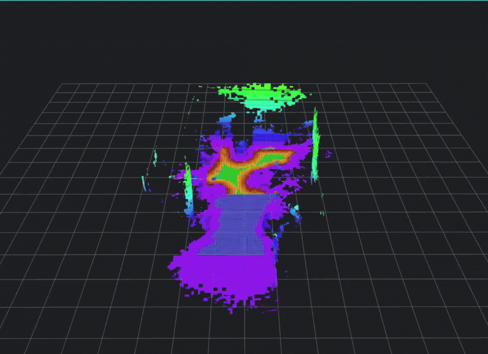
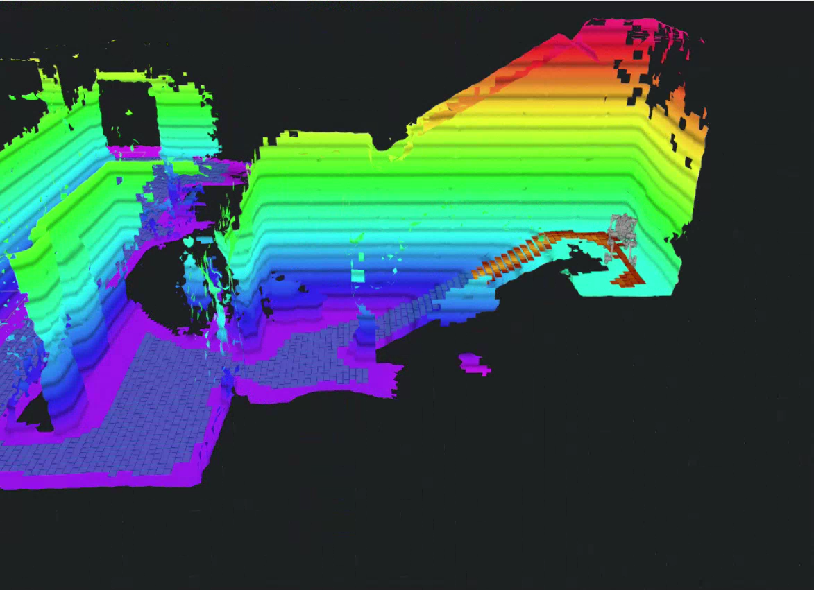
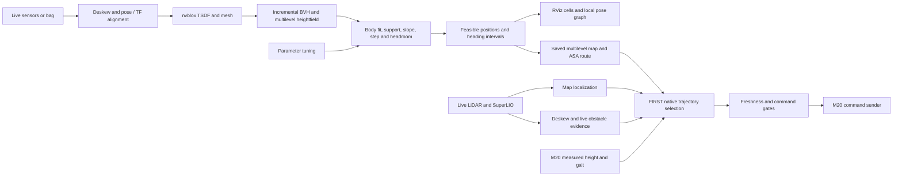

<div align="center">

# SE(2) Nvblox Traversability

**From 3D reconstruction to terrain you can reason about.**

Mesh-based traversability, ASA global routing, and FIRST-based local navigation for the M20 quadruped.

[English](README.md) · [简体中文](README.zh-CN.md)

[](https://docs.ros.org/en/humble/)
[](LICENSE)

[Demo](#demo) · [Quick start](#quick-start) · [Live navigation](official_first_integration/README.md) · [Global planning](docs/global-planning.md) · [Architecture](docs/architecture.md) · [Jetson integration](docs/jetson.md) · [Validation](docs/validation.md)

</div>

SE(2) Nvblox Traversability turns an incremental [nvblox](https://github.com/nvidia-isaac/nvblox) mesh into a local map of feasible robot positions and headings. It checks the robot's physical envelope, floor support, step height, slope, and headroom, then shows how much heading freedom remains in each cell. A ROS 2 interface supports sensor recording, reconstruction from bags, parameter comparison, and RViz inspection.

The current live navigation chain uses **ASA for global planning** and a **trajectory-library local planner** with collision correspondence tables, candidate scoring, and straight-line/autonomous obstacle avoidance. The default `source` backend is built from this repository. ScanPlanner remains available as an earlier integration.

Developed on an M20 robot with a Jetson Orin NX, dual LiDAR, and a RealSense D435i. The geometry core also builds and runs on a Linux CPU without ROS, CUDA, or robot hardware.

## Demo

[](docs/media/demo-full.mp4)

**[Watch or download the full demo · 3:56 · MP4](docs/media/demo-full.mp4)**

Recorded September 30, 2026. The preview contains two short excerpts at original speed; the full video retains the complete recording. This video demonstrates reconstruction and traversability, not the later FIRST driving tests. Rainbow colors encode mesh height. Green and orange cells encode current traversability; blue areas retain historical results.

<details>
<summary>Staircase view</summary>



</details>

## Highlights

- **Physical fit in narrow passages.** Feasible poses can lie inside a grid cell and between sampled headings. A passage just wide enough for the body can retain a chain of orange cells through the existing classifier.
- **Heading freedom at a glance.** Deep orange indicates a very narrow feasible heading interval; lighter orange indicates more freedom. Green requires feasibility across all headings with the configured margins.
- **Floors stay distinct.** A multilevel heightfield and local surface connectivity prevent an upper-floor edge from becoming a spurious obstacle on the floor below.
- **Incremental geometry.** A native C++/OpenMP core updates a robot-centered window from changed mesh blocks. Historical areas remain visible with separate validity semantics.
- **Record once, compare parameters.** Record sensor inputs without mesh reconstruction, keep a bag with its map and telemetry, rebuild from LiDAR, depth, or both, and tune while replay is paused.
- **Cross-floor goal planning.** Build a static all-floor map from a bag and select a 3D goal in RViz. A paper-based A* → string pulling → heading A* planner produces a checked route through stairs. [Workflow and relation to SE(2) NavMesh →](docs/global-planning.md)
- **Live map localization and local avoidance.** Match measured LiDAR surfaces to the saved reference, follow the ASA route using 4,641 native velocity primitives, and check live occupancy before sending M20 commands. A bounded continuity preference reduces switching between similarly rated trajectories.
- **RViz and robot state.** Height-colored meshes, traversability cells, and an M20 joint model share the reconstruction frame. Replay suspends the live reconstruction view; a button restores it.

This is a research and integration project. Geometry analysis and replay do not issue motion commands. The optional M20 integration enables hardware output only with `--execute`. A supervised flat-route trial reached its target; cross-floor physical execution and full vendor-state-machine equivalence remain unverified. See [execution evidence](official_first_integration/evidence/execution-trials.md) and [current limits](#current-limits).

## Quick start

### Live navigation on the configured M20 / Jetson

Use the existing project directory on the robot. **Start with hardware command output enabled:**

```bash
bash /home/nvidia/scanplanner_test/se2_nvblox_surface_shadow/official_first_integration/start_live.sh --execute --enter-navigation
```

**Stop the owned navigation session:**

```bash
bash /home/nvidia/scanplanner_test/se2_nvblox_surface_shadow/official_first_integration/stop.sh
```

For telemetry and visualization without velocity or mode changes, run `start_live.sh` without either flag. After localization succeeds, use RViz **Publish Point** to choose a green/orange surface on the destination floor. The yellow path is the ASA route; FIRST displays its local trajectory and the actual classified obstacle points, alongside the measured M20 URDF.

Wait for the global planner's `ready` status: the static graph is prepared once at startup. Validated map geometry is cached across restarts. Two measured routes took 0.56–0.91 s with that cache; first validation took 1.52–2.93 s. See [ASA latency measurements and limits](docs/asa-latency.md).

Startup searches **the selected recorded map by default**, using measured scans within 8 m and position/heading hypotheses across mapped floors. It does not trust the previous session's endpoint. Refined matching, independent structural constraints, competing-pose checks, and five fresh stable confirmations precede localization output. Indistinguishable floors or insufficient observations remain unresolved. Use `--recording-start` to restrict the search to the recording origin, or `--initial-map-pose X Y Z YAW` (metres, radians) for a known search center; neither bypasses matching. The local obstacle-planning cloud range is unchanged.

The default saved map is `scanplanner_integration/maps/20261012_confirmed_scene`; select another prepared map with `--map DIRECTORY`. Live navigation uses the current measured pose, while the separate bag-planning viewer can use a recorded endpoint. Stopping sends zero-velocity packets before shutting down the other owned processes and requests restoration of the prior usage mode; sender logs record the outcome.

### Prepare a new Jetson deployment

The CPU example below does not install the robot stack. A new hardware deployment needs:

| Component | Requirement |
| --- | --- |
| Runtime | ROS 2 Humble, C++17/CMake, Eigen3, and the project's ROS-enabled Python environment |
| Live inputs | M20 LiDAR and IMU drivers, SuperLIO body odometry, calibrated frame conventions and clock synchronization |
| Saved map | A built `navmesh.json` bundle and source mesh; optional verified LiDAR localization reference |
| FIRST assets | Locally supplied official trajectory/collision archive, verified against the included manifest |
| Robot link | Reachable M20 command/status interfaces and private NOS relay authentication |
| Reconstruction | Installed nvblox/Isaac ROS and project CUDA adapters when building maps or replaying sensors |

```bash
# From the repository root, with the separately supplied asset archive:
python3 official_first_integration/import_assets.py /path/to/official_planner.tgz
bash official_first_integration/build.sh
```

The archive, private credentials, field bags, generated maps and prebuilt binaries are **not shipped in Git**. Deployment paths and network addresses must match the target system. See the [FIRST integration guide](official_first_integration/README.md), [Jetson setup](docs/jetson.md), and [map-building workflow](docs/global-planning.md).


### Run the geometry core on a CPU

Requirements: Linux, Python 3.10+, a C++17 compiler with OpenMP, and the packages in [requirements-core.txt](requirements-core.txt).

```bash
git clone https://arcusgit.vip.cpolar.cn/liuzhenghao/se2-nvblox-traversability.git
cd se2-nvblox-traversability

# Ubuntu / Debian build prerequisites
sudo apt-get install build-essential python3-venv
python3 -m venv .venv
source .venv/bin/activate
python -m pip install -r requirements-core.txt

bash scripts/test_core.sh
python examples/narrow_passage.py
```

The example runs the production geometry classifier on synthetic corridors. A 0.506 m body fits the 0.506 m corridor with restricted headings; a 0.500 m corridor is rejected. Wider corridors admit larger heading intervals. These are geometric fixtures, not measurements from the demo.

The check script builds the native library and runs the focused geometry, graph, color, local-window, and floor-separation regressions, followed by the bag-management and robot-model unit tests. Hardware smoke scripts are separate and are not started by this command.

### Reconstruction and bag tools

On the existing M20 deployment, the tuning interface starts with:

```bash
bash /home/nvidia/scanplanner_test/se2_terrain_check/start_after_boot.sh
```

Select a bag, enable reconstruction, choose the sensor input, and open replay in RViz. The default reconstruction profile uses LiDAR with deskewing; replay uses the **recorded poses**, rather than rerunning odometry estimation. Use **Restore live reconstruction / 恢复实时重建** to return to live input.

For a bag with a built global map, click **全局路径规划**, then use RViz **Publish Point** on the destination floor. The start defaults to the recorded bag endpoint. See the [global planning guide](docs/global-planning.md).

The earlier [ScanPlanner integration](docs/scanplanner-integration.md) remains available for comparison. The current live start/stop commands are those under `official_first_integration/` above.

A fresh machine also needs the ROS 2/nvblox stack, sensor drivers, odometry, calibrated transforms, and deployment services. Those external components are not installed by the CPU quick start. Follow the [Jetson integration guide](docs/jetson.md) and [bag workflow](bag_tools/README.md).

## How it works



The classifier first uses conservative grid footprints to establish feasibility efficiently. Unresolved states are refined against the current mesh using the physical body footprint. Local graph nodes retain the actual feasible poses; refined edges check the swept footprint between poses. Changed geometry and parameters invalidate affected results. See [architecture and interfaces](docs/architecture.md).

| Display | Meaning |
| --- | --- |
| Green | All headings feasible with configured clearance margins |
| Deep → light orange | Increasing total feasible heading angle; physical fit may have insufficient lateral comfort margin |
| Blue | Historical geometry results, not current traversability permission |
| Rainbow mesh | Surface height, independent of traversability color |

## Validation

### Current live navigation — October 13, 2026

A supervised flat-route trial reached the original RViz goal; measured start-to-final displacement was **8.29 m**. The operator reported essentially smooth motion. Sampled tracking reports contained no acquisition-age or expired-plan holds, but short collision, terminal-collision and generation-change holds remained.

| Measurement | Median / P90 |
| --- | ---: |
| Local planning computation | 12.2 / 23.5 ms |
| Point-cloud processing | 68.0 / 87.7 ms |
| Source-cloud age at command check | 204 / 272 ms |

These are separate pipeline measurements, not an end-to-end 50 ms guarantee. Commands are scheduled at 30 Hz; an uninterrupted hardware minimum of 20 Hz is not established. The later continuity preference passed native-library tests and an isolated ROS stop/cancel/timeout regression; its additional physical smoothing benefit has not yet been measured. [Trial records and remaining issues →](official_first_integration/evidence/execution-trials.md)

### Reconstruction and traversability replay — September 29, 2026

The September 29 validation used a **326.63 s LiDAR replay on Jetson Orin NX 16 GB**. These results describe that run; the demonstration video is a separate recording.

| Measurement | Recorded result |
| --- | ---: |
| LiDAR frames integrated | 3,264 / 3,266; 2 startup drops |
| Distinct mesh geometry updates | 12.42 Hz |
| Distinct traversability results | **1.93 Hz** |
| Oldest-input-to-result latency, median / P95 | **940 / 1,425 ms** |
| Doorway graph checks at 75 / 85 / 90 s | Connected in all three frozen mesh snapshots |
| Geometry / graph / display regression suite | 21 tests passed on x86 and Jetson |

The finer physical-clearance classifier currently has substantial CPU cost. **That reconstruction/classification run did not meet its historical >10 Hz / P95 <50 ms target.** Mesh publishing rate is not traversability update rate. Snapshot connectivity checks do not establish route connectivity throughout a complete building. [Method, scope, and machine-readable results →](docs/validation.md)

## Repository layout

| Path | Purpose |
| --- | --- |
| [`terrain_variants/local_window/`](terrain_variants/local_window/) | Current replay geometry core, pose graph, and display |
| [`terrain_variants/baseline/`](terrain_variants/baseline/) | Earlier reference implementation for comparisons |
| [`terrain_variants/deskew/`](terrain_variants/deskew/) · [`fast_lidar/`](terrain_variants/fast_lidar/) | LiDAR motion compensation and Jetson CUDA conversion |
| [`bag_tools/`](bag_tools/) | Recording, reconstruction, tuning integration, lifecycle management |
| [`global_planner/`](global_planner/) | Complete-bag map building, yaw-layered ASA planning, and RViz 3D goals |
| [`official_first_integration/`](official_first_integration/) | Current FIRST-based execution, localization, telemetry, collision checks, tests and evidence |
| [`scanplanner_integration/`](scanplanner_integration/) | Earlier ScanPlanner integration and shared localization/odometry helpers |
| [`robot_model/`](robot_model/) | M20 joint-state adapter, namespaced TF, and upstream model |
| [`launch/`](launch/) · [`config/`](config/) | ROS 2 package launch and configuration |
| [`deployment/jetson/`](deployment/jetson/) | Existing deployment entry points and configuration snapshots |
| [`examples/`](examples/) · [`docs/`](docs/) | CPU example, integration notes, validation, and demo |

## Current limits

- The local planner uses trajectory and collision tables, with terrain-specific perception and task/gait handling. Offline tests and simulated stair execution do not establish physical staircase acceptance or support for every robot configuration. See the [implementation scope](official_first_integration/README.md).
- Cross-floor **geometric planning** is implemented; supervised arrival evidence above is on flat ground. It does not establish physical staircase acceptance.
- The live FIRST layer does not veto candidates for missing support in the old map. It uses saved heights only as relative terrain references and live odometry/body height as the ground datum. This is distinct from map-build support checks and does not provide live hole/drop-off detection.
- Near-body return clusters and short collision holds remain under investigation. No blanket occupancy expiry or intensity-only filtering is used to erase these points.

- Geometry quality depends on sensing, calibration, odometry, and TSDF integration. Reflective surfaces, missing observations, and open-riser stairs can still leave incomplete geometry.
- Ground support is checked at finite resolution. The model is a body envelope with terrain constraints, not a legged dynamics, contact, or gait-feasibility solver.
- Live classification is valid within the current local window. The global planner checks paths against a frozen complete-bag mesh; historical displays and saved routes do not establish validity after the environment changes.
- Raw field bags are not included. Synthetic tests are reproducible from this repository; field results are documented with aggregate evidence.
- Jetson integration contains deployment-specific paths and service dependencies. CUDA adapters must be built against the installed nvblox library; prebuilt binaries are not distributed.

## Contributing

See [CONTRIBUTING.md](CONTRIBUTING.md) for the core checks and useful information to include in a bug report. Changes to collision or support behavior should include a geometry fixture that demonstrates the intended result.

## License and acknowledgments

Project code is licensed under [Apache 2.0](LICENSE). Third-party model assets and reference sources retain their own licenses; see [THIRD_PARTY_NOTICES.md](THIRD_PARTY_NOTICES.md).

Built with [NVIDIA nvblox](https://github.com/nvidia-isaac/nvblox), [Isaac ROS nvblox](https://github.com/NVIDIA-ISAAC-ROS/isaac_ros_nvblox), and [ROS 2](https://github.com/ros2). M20 model assets come from [DeepRoboticsLab](https://github.com/DeepRoboticsLab/deep_robotics_model). This is an independent project and is not an official release by these organizations.
