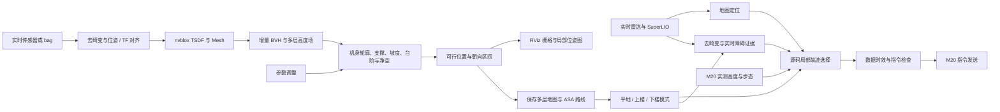

<div align="center">

# SE(2) Nvblox Traversability

**从三维重建，走向可解释的地形通行分析。**

面向 M20 的 Mesh 通行性分析、ASA 全局路径规划与 FIRST 局部导航。

[English](README.md) · [简体中文](README.zh-CN.md)

[](https://docs.ros.org/en/humble/)
[](LICENSE)

[演示](#演示) · [快速开始](#快速开始) · [实机导航](official_first_integration/README.md) · [全局规划](docs/global-planning.md#简体中文) · [算法架构](docs/architecture.md) · [Jetson 部署](docs/jetson.md) · [验证结果](docs/validation.md)

</div>

SE(2) Nvblox Traversability 将 [nvblox](https://github.com/nvidia-isaac/nvblox) 的增量 Mesh 转换为包含机器人可行位置与朝向的局部通行地图。算法检查实际机身轮廓、地面支撑、台阶、坡度和顶部净空，并通过栅格颜色表达可通行朝向的自由度。ROS 2 调参界面支持传感器录制、bag 重建、参数对比和 RViz 查看。

当前默认链路采用 **ASA 全局规划 + 基于轨迹库的局部规划**，结合碰撞对应表进行候选轨迹筛选和评分；运行时使用本项目编译的 `source` 后端。**跨楼层导航已完成整条执行链接入：** ASA 地形分段驱动局部感知、导航参数、步态请求和路径执行。当前执行入口位于 `official_first_integration/`。

项目基于 M20 机器人、Jetson Orin NX、双雷达和 RealSense D435i 开发。几何核心也可以在 Linux CPU 上独立编译运行，无需 ROS、CUDA 或机器人硬件。

## 演示

[](docs/media/demo-full.mp4)

**[观看或下载完整演示 · 3 分 56 秒 · MP4](docs/media/demo-full.mp4)**

录制于 2026 年 9 月 30 日。动态预览选取两个片段，保持原速；完整视频保留全部录屏内容。这段视频展示重建与通行性。彩虹色表示 Mesh 高度，绿色和橙色表示当前通行性，蓝色区域保留历史结果。

<details>
<summary>查看楼梯场景</summary>


</details>

## 核心能力

- **按实际轮廓判断狭窄通道。** 可行位姿能够位于格子内部、采样朝向之间；仅容得下机身的通道，也可以通过原有分类器自然保留一串橙色格子。
- **用颜色表达朝向自由度。** 深橙表示可行朝向区间很窄，浅橙表示朝向空间更大；绿色要求所有朝向均满足设置的余量。
- **保持楼层独立。** 多层高度场结合局部表面连通关系，避免把上层边缘直接投影成下层障碍。
- **增量处理当前区域。** C++/OpenMP 核心从变化的 Mesh 块更新机器人附近窗口；历史区域继续显示，并保留独立的有效性语义。
- **一次录制，多次调参。** 录制时关闭 Mesh 重建以节省资源；bag、地图与遥测绑定管理；支持纯雷达、深度或融合重建，以及暂停回放后继续调参。
- **点选跨楼层目标。** 从整包构建静态多层通行图，在 RViz 点击三维目标，经 A* → 路径拉直 → 朝向 A* 得到通过楼梯的已检查路径，并将平地／上楼／下楼标注交给实机执行链。[使用方法及与 SE(2) NavMesh 论文的对应关系 →](docs/global-planning.md#简体中文)
- **实时定位与局部避障。** 用实测雷达与保存参考地图匹配，沿 ASA 路线从 4,641 条原生速度轨迹中选路，并根据实时占据检查后发送 M20 指令。已接入全地图首次定位和连续里程计会话内的有限范围恢复。
- **统一 RViz 显示与机身状态。** 显示高度着色 Mesh、通行栅格与 M20 实测关节模型；回放时暂停实时重建视图，并提供恢复按钮。

本项目用于研究与系统集成。几何分析和回放不发送运动指令；可选的 M20 接入仅在显式指定 `--execute` 后启用硬件输出。默认后端已接通跨楼层规划与执行。软件测试和现场测量范围见[当前验证记录](docs/validation.md)，部署边界见[当前限制](#当前限制)。

## 快速开始

### 当前 M20 / Jetson 实机导航

在机器人现有项目目录中运行。**启动并启用运动指令：**

```bash
bash /home/nvidia/scanplanner_test/se2_nvblox_surface_shadow/official_first_integration/start_live.sh --execute --enter-navigation
```

**停止本项目拥有的导航会话：**

```bash
bash /home/nvidia/scanplanner_test/se2_nvblox_surface_shadow/official_first_integration/stop.sh
```

仅查看遥测和可视化时，运行不带这两个参数的 `start_live.sh`，不会发送速度或切换模式。定位成功后，在 RViz 使用 **Publish Point** 点击目标楼层的绿色或橙色地面。黄色为 ASA 全局路径；FIRST 显示局部轨迹和实际参与避障的障碍点云，同时显示 M20 实测姿态模型。

请等全局规划器进入 `ready`：固定搜索图在启动时准备一次，地图几何检查结果支持跨重启复用。两条测试路线复用后耗时 0.56–0.91 秒，首次验证耗时 1.52–2.93 秒，详见 [ASA 延迟测试与限制](docs/asa-latency.md)。

ASA 的地图接入检查仍保留。当前 `source` 后端实现轨迹评分与直线/自主避障状态，默认使用 ±4 m 点云裁剪；普通选点由 ASA 从地图连续踏面标注平地／上楼／下楼段，将路径和导航属性一并交给源码执行端，默认自主避障；执行端按段切换规划参数与步态，不额外复检机身。保存任务仍使用其显式 `Gait` 和导航属性。局部前瞻为 1.5 米；ASA 使用 0.45 米净空偏好及非绿色区域软代价，使路线优先居中。详见[实机导航说明](official_first_integration/README.md)。

**默认在当前已录制地图范围内自动首次定位，不要求回到录包起点，也不使用上次终点作为可信位姿。** 初始化使用 8 米范围的实测扫描，从地图通行区域和录制轨迹产生多楼层位置候选，并搜索全朝向；精配准、结构约束、候选歧义及五次新鲜稳定确认通过后才发布定位。相似楼层或观测不足时仍会等待。`--recording-start` 可显式限制到录包起点附近；`--initial-map-pose X Y Z YAW`（米、弧度）可指定已知搜索中心，仍须通过匹配。局部避障点云范围不随定位观察范围改变。

默认地图为 `scanplanner_integration/maps/20261012_confirmed_scene`，通过 `--map DIRECTORY` 指定其他已构建地图。实机导航使用当前实测定位；独立 bag 全局规划界面可使用录制终点。停止时先发送零速度，再关闭其他所属进程，并请求恢复此前控制模式；发送结果记入日志。

### 新 Jetson 的部署前提

下面的 CPU 示例不会安装机器人软件栈。新机器还需要：

| 组件 | 依赖 |
| --- | --- |
| 运行环境 | ROS 2 Humble、C++17/CMake、Eigen3 和可使用 ROS 的 Python 环境 |
| 实时输入 | M20 雷达与 IMU 驱动、SuperLIO 机身里程计、已标定坐标系及时间同步 |
| 保存地图 | 已构建的 `navmesh.json` 地图包及源 Mesh；可选的已校验雷达定位参考 |
| FIRST 资源 | 另行提供的官方轨迹/碰撞归档，通过仓库 manifest 校验 |
| 机器人通信 | 可达的 M20 指令/状态接口，以及单独配置的 NOS 遥测转发凭据 |
| 重建环境 | 建图或传感器回放所需的 nvblox/Isaac ROS 和项目 CUDA 适配器 |

```bash
# 在仓库根目录执行，归档文件需要另外提供：
python3 official_first_integration/import_assets.py /path/to/official_planner.tgz
bash official_first_integration/build.sh
bash scanplanner_integration/build_stair_lio.sh
```

Git 中**不包含**上述官方归档、私有凭据、实地 bag、生成地图和预编译二进制。部署路径及网络地址须与目标设备一致。详见 [FIRST 接入说明](official_first_integration/README.md)、[Jetson 环境](docs/jetson.md)和[地图构建流程](docs/global-planning.md#简体中文)。


### 在 CPU 上运行几何核心

依赖：Linux、Python 3.10+、支持 OpenMP 的 C++17 编译器，以及 [requirements-core.txt](requirements-core.txt) 中的 Python 包。

```bash
git clone https://arcusgit.vip.cpolar.cn/liuzhenghao/se2-nvblox-traversability.git
cd se2-nvblox-traversability

# Ubuntu / Debian 编译依赖
sudo apt-get install build-essential python3-venv
python3 -m venv .venv
source .venv/bin/activate
python -m pip install -r requirements-core.txt

bash scripts/test_core.sh
python examples/narrow_passage.py
```

示例使用实际几何分类器计算构造通道：0.506 m 宽的机身在 0.506 m 通道内保留受限朝向，0.500 m 通道被拒绝；通道变宽时，可行朝向范围随之增加。这些是可复现的几何测试场景，并非演示视频中的测量结果。

检查脚本编译原生库，运行几何、图连接、颜色、局部窗口和楼层分离回归，再运行 bag 管理与关节模型单元测试。实机冒烟脚本独立保留，不会随此命令启动。

### 重建、录包和回放

现有 M20 部署的调参界面启动命令：

```bash
bash /home/nvidia/scanplanner_test/se2_terrain_check/start_after_boot.sh
```

选中 bag，启用重新建图，选择传感器输入，再打开 RViz 回放。默认使用带去畸变的纯雷达方案；重建使用**包内已录位姿**，不会重新估计里程计。点击 **恢复实时重建** 返回实时输入。

对于已构建全局图的 bag，点击 **全局路径规划**，再在 RViz 用 **Publish Point** 点击目标楼层地面。默认起点为录制终点，详见[全局规划说明](docs/global-planning.md#简体中文)。

全新机器还需要 ROS 2/nvblox、传感器驱动、里程计、标定 TF 和部署服务。CPU 快速开始不会安装这些外部组件，具体见 [Jetson 集成说明](docs/jetson.md) 和 [bag 操作流程](bag_tools/README.md)。

## 工作原理



算法先使用保守栅格足迹快速确认可行状态；对于仍未确定的状态，再根据当前 Mesh 检查实际机身轮廓。局部图节点保留真实可行位姿，细化后的边检查位姿之间运动时扫过的轮廓。观测或参数变化会撤销受影响的旧结果，详见[算法与接口](docs/architecture.md)。

| 显示 | 含义 |
| --- | --- |
| 绿色 | 所有朝向均满足设置的净空余量 |
| 深橙 → 浅橙 | 可行朝向总角宽增加；实际轮廓可通过，但可能不足设置的侧向余量 |
| 蓝色 | 历史几何结果，不代表当前通行许可 |
| 彩虹色 Mesh | 表面高度，与通行性颜色相互独立 |

## 验证结果

当前链路已接通跨楼层 ASA 路线、按地形切换的局部避障、步态事务与指令输出。组件回归、软件执行测试和现场测量分别记录。

| 组件 | 最近一次记录的验证 |
| --- | --- |
| 全地图首次定位 | 未提供初始位姿，导航机实时输入约 **30.65 秒**进入跟踪，随后 **66 次有效跟踪** |
| 连续里程计定位恢复 | 实时输入约 **3.80 秒**恢复，随后 **60 次有效跟踪** |
| 定位回归 | 工作站和 Jetson 均通过 9 项初始化／参考匹配测试和 3 项传输测试 |
| 楼梯导航 | 51 项源码测试、23 项 ASA 测试及 12 级上／下楼软件执行测试通过 |

上述实时定位测量在静止状态进行，没有发送运动指令。跨楼层接入已完成；这些测量不代表所有楼梯及运动中定位恢复的可靠性验收。[验证范围与带日期的证据 →](docs/validation.md)

## 目录结构

| 路径 | 用途 |
| --- | --- |
| [`terrain_variants/local_window/`](terrain_variants/local_window/) | 当前回放使用的几何核心、位姿图和显示 |
| [`terrain_variants/deskew/`](terrain_variants/deskew/) · [`fast_lidar/`](terrain_variants/fast_lidar/) | 雷达运动补偿与 Jetson CUDA 转换 |
| [`bag_tools/`](bag_tools/) | 录制、重建、调参集成和包管理 |
| [`global_planner/`](global_planner/) | 整包全局图、朝向分层 ASA 规划和 RViz 三维选点 |
| [`official_first_integration/`](official_first_integration/) | 当前 FIRST 执行链路、定位、遥测、碰撞检查、测试与证据 |
| [`scanplanner_integration/`](scanplanner_integration/) | 共享定位、里程计与密集机身点云接入 |
| [`robot_model/`](robot_model/) | M20 关节转换、专用 TF 和上游模型 |
| [`launch/`](launch/) · [`config/`](config/) | ROS 2 包启动与配置 |
| [`deployment/jetson/`](deployment/jetson/) | 现有部署入口和配置快照 |
| [`examples/`](examples/) · [`docs/`](docs/) | CPU 示例、集成说明、验证和 Demo |

## 当前限制

- 跨楼层导航使用同一张具有连通楼梯的保存地图。保存任务的跨地图动作（`PointInfo=4` / `MapID`）不在当前任务接口支持范围内。
- 重复楼层、观测不足、遮挡或地图变化可能导致定位歧义；系统等待有效匹配和稳定确认。
- 几何质量依赖传感器、标定、里程计及 TSDF 积分；有限分辨率的机身／支撑检查不求解足端接触，也不保证实时坑洞、悬崖检测。
- 全局路径依据保存 Mesh，局部避障依据实时障碍观测；环境变化可能需要重建保存地图。
- 运行延迟取决于场景复杂度和硬件负载，30 Hz 指令调度不等于保证最低交付频率。
- 仓库不分发原始实地 bag、生成地图、私有凭据和预编译二进制；部署路径、外部服务及 CUDA 依赖须与目标设备一致。

## 参与贡献

检查命令和问题反馈要求见 [CONTRIBUTING.md](CONTRIBUTING.md)。修改碰撞或支撑判据时，请提供能说明预期行为的几何测试场景。

## 许可与致谢

项目代码采用 [Apache 2.0](LICENSE)。第三方模型与参考源码保留各自许可，详见 [THIRD_PARTY_NOTICES.md](THIRD_PARTY_NOTICES.md)。

本项目使用 [NVIDIA nvblox](https://github.com/nvidia-isaac/nvblox)、[Isaac ROS nvblox](https://github.com/NVIDIA-ISAAC-ROS/isaac_ros_nvblox) 和 [ROS 2](https://github.com/ros2)，M20 模型来自 [DeepRoboticsLab](https://github.com/DeepRoboticsLab/deep_robotics_model)。本项目独立开发，并非上述组织的官方发布。
