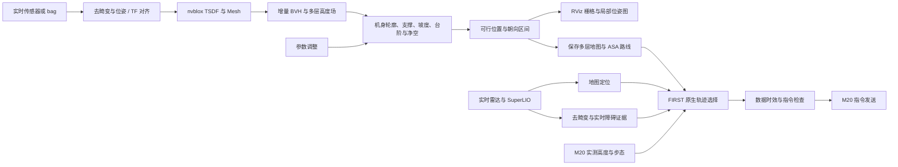

<div align="center">

# SE(2) Nvblox Traversability

**从三维重建，走向可解释的地形通行分析。**

面向 M20 的 Mesh 通行性分析、ASA 全局路径规划与 FIRST 局部导航。

[English](README.md) · [简体中文](README.zh-CN.md)

[](https://docs.ros.org/en/humble/)
[](LICENSE)

[演示](#演示) · [快速开始](#快速开始) · [实机导航](official_first_integration/README.md) · [全局规划](docs/global-planning.md#简体中文) · [算法架构](docs/architecture.md) · [Jetson 部署](docs/jetson.md) · [验证结果](docs/validation.md)

</div>

SE(2) Nvblox Traversability 将 [nvblox](https://github.com/nvidia-isaac/nvblox) 的增量 Mesh 转换为包含机器人可行位置与朝向的局部通行地图。算法检查实际机身轮廓、地面支撑、台阶、坡度和顶部净空，并通过栅格颜色表达可通行朝向的自由度。ROS 2 调参界面支持传感器录制、bag 重建、参数对比和 RViz 查看。

当前默认链路采用 **ASA 全局规划 + NOS 局部规划源码复现**，复用已提取的官方轨迹库与碰撞对应表；运行时不加载官方规划二进制。已接入保存点步态/参数事务，完整上楼与跨地图流程仍未验收。ScanPlanner 保留为早期实现，当前执行入口位于 `official_first_integration/`。

项目基于 M20 机器人、Jetson Orin NX、双雷达和 RealSense D435i 开发。几何核心也可以在 Linux CPU 上独立编译运行，无需 ROS、CUDA 或机器人硬件。

## 演示

[](docs/media/demo-full.mp4)

**[观看或下载完整演示 · 3 分 56 秒 · MP4](docs/media/demo-full.mp4)**

录制于 2026 年 9 月 30 日。动态预览选取两个片段，保持原速；完整视频保留全部录屏内容。这段视频展示重建与通行性，不代表后来 FIRST 实机运动测试。彩虹色表示 Mesh 高度，绿色和橙色表示当前通行性，蓝色区域保留历史结果。

<details>
<summary>查看楼梯场景</summary>


</details>

## 核心能力

- **按实际轮廓判断狭窄通道。** 可行位姿能够位于格子内部、采样朝向之间；仅容得下机身的通道，也可以通过原有分类器自然保留一串橙色格子。
- **用颜色表达朝向自由度。** 深橙表示可行朝向区间很窄，浅橙表示朝向空间更大；绿色要求所有朝向均满足设置的余量。
- **保持楼层独立。** 多层高度场结合局部表面连通关系，避免把上层边缘直接投影成下层障碍。
- **增量处理当前区域。** C++/OpenMP 核心从变化的 Mesh 块更新机器人附近窗口；历史区域继续显示，并保留独立的有效性语义。
- **一次录制，多次调参。** 录制时关闭 Mesh 重建以节省资源；bag、地图与遥测绑定管理；支持纯雷达、深度或融合重建，以及暂停回放后继续调参。
- **点选跨楼层目标。** 从整包构建静态多层通行图，在 RViz 点击三维目标，经 A* → 路径拉直 → 朝向 A* 得到通过楼梯的已检查路径。[使用方法及与 SE(2) NavMesh 论文的对应关系 →](docs/global-planning.md#简体中文)
- **实时定位与局部避障。** 用实测雷达与保存参考地图匹配，沿 ASA 路线从 4,641 条原生速度轨迹中选路，并根据实时占据检查后发送 M20 指令。有限幅度的速度连续性偏好减少近似等价轨迹之间反复切换。
- **统一 RViz 显示与机身状态。** 显示高度着色 Mesh、通行栅格与 M20 实测关节模型；回放时暂停实时重建视图，并提供恢复按钮。

本项目用于研究与系统集成。几何分析和回放不发送运动指令；可选的 M20 接入仅在显式指定 `--execute` 后启用硬件输出。已完成一次有人监护的平地到达测试；跨楼层实机执行和完整官方状态机等价性仍未验证。参阅[实测记录](official_first_integration/evidence/execution-trials.md)和[当前限制](#当前限制)。

## 快速开始

### 当前 M20 / Jetson 实机导航

在机器人现有项目目录中运行。**启动并启用运动指令：**

```bash
bash /home/nvidia/scanplanner_test/se2_nvblox_surface_shadow/official_first_integration/start_live.sh --execute --enter-navigation
```

**停止本项目拥有的导航会话：**

```bash
bash /home/nvidia/scanplanner_test/se2_nvblox_surface_shadow/official_first_integration/stop.sh
```

仅查看遥测和可视化时，运行不带这两个参数的 `start_live.sh`，不会发送速度或切换模式。定位成功后，在 RViz 使用 **Publish Point** 点击目标楼层的绿色或橙色地面。黄色为 ASA 全局路径；FIRST 显示局部轨迹和实际参与避障的障碍点云，同时显示 M20 实测姿态模型。

请等全局规划器进入 `ready`：固定搜索图在启动时准备一次，地图几何检查结果支持跨重启复用。两条测试路线复用后耗时 0.56–0.91 秒，首次验证耗时 1.52–2.93 秒，详见 [ASA 延迟测试与限制](docs/asa-latency.md)。

ASA 的地图接入检查仍保留。当前 `source` 后端按反汇编实现轨迹评分与直线/自主避障状态，默认使用官方 ±4 m 点云裁剪；普通选点由 ASA 从地图连续踏面标注平地／上楼／下楼段，将路径和导航属性一并交给源码执行端，默认自主避障；执行端按段切换官方参数与步态，不额外复检机身。保存任务仍使用其显式 `Gait` 和导航属性。之前的 0.22 秒平滑、连续性偏好及递增回退属于 `legacy` 后端，不是当前默认行为。详见 [源码接入与完成边界](official_first_integration/README.md)。

**默认从录包起点附近搜索，不自动读取上次终点的位置缓存。** `--recording-start` 仍兼容，但不再必需。如需指定其他已知区域，可传入 `--initial-map-pose X Y Z YAW`（米、弧度）；初值仍需通过点云匹配。初始化使用 ±2 米范围、0.5 米间距的种子偏移与全朝向假设，并限制在搜索中心水平 3 米、垂直 0.5 米内；这不是任意整栋建筑的全局位置识别。

默认地图为 `scanplanner_integration/maps/20261012_confirmed_scene`，通过 `--map DIRECTORY` 指定其他已构建地图。实机导航使用当前实测定位；独立 bag 全局规划界面可使用录制终点。停止时先发送零速度，再关闭其他所属进程，并请求恢复此前控制模式；发送结果记入日志。

### 新 Jetson 的部署前提

下面的 CPU 示例不会安装机器人软件栈。新机器还需要：

| 组件 | 依赖 |
| --- | --- |
| 运行环境 | ROS 2 Humble、C++17/CMake、Eigen3 和可使用 ROS 的 Python 环境 |
| 实时输入 | M20 雷达与 IMU 驱动、SuperLIO 机身里程计、已标定坐标系及时间同步 |
| 保存地图 | 已构建的 `navmesh.json` 地图包及源 Mesh；可选的已校验雷达定位参考 |
| FIRST 资源 | 另行提供的官方轨迹/碰撞归档，通过仓库 manifest 校验 |
| 机器人通信 | 可达的 M20 指令/状态接口，以及单独配置的 NOS 遥测转发凭据 |
| 重建环境 | 建图或传感器回放所需的 nvblox/Isaac ROS 和项目 CUDA 适配器 |

```bash
# 在仓库根目录执行，归档文件需要另外提供：
python3 official_first_integration/import_assets.py /path/to/official_planner.tgz
bash official_first_integration/build.sh
```

Git 中**不包含**上述官方归档、私有凭据、实地 bag、生成地图和预编译二进制。部署路径及网络地址须与目标设备一致。详见 [FIRST 接入说明](official_first_integration/README.md)、[Jetson 环境](docs/jetson.md)和[地图构建流程](docs/global-planning.md#简体中文)。


### 在 CPU 上运行几何核心

依赖：Linux、Python 3.10+、支持 OpenMP 的 C++17 编译器，以及 [requirements-core.txt](requirements-core.txt) 中的 Python 包。

```bash
git clone https://arcusgit.vip.cpolar.cn/liuzhenghao/se2-nvblox-traversability.git
cd se2-nvblox-traversability

# Ubuntu / Debian 编译依赖
sudo apt-get install build-essential python3-venv
python3 -m venv .venv
source .venv/bin/activate
python -m pip install -r requirements-core.txt

bash scripts/test_core.sh
python examples/narrow_passage.py
```

示例使用实际几何分类器计算构造通道：0.506 m 宽的机身在 0.506 m 通道内保留受限朝向，0.500 m 通道被拒绝；通道变宽时，可行朝向范围随之增加。这些是可复现的几何测试场景，并非演示视频中的测量结果。

检查脚本编译原生库，运行几何、图连接、颜色、局部窗口和楼层分离回归，再运行 bag 管理与关节模型单元测试。实机冒烟脚本独立保留，不会随此命令启动。

### 重建、录包和回放

现有 M20 部署的调参界面启动命令：

```bash
bash /home/nvidia/scanplanner_test/se2_terrain_check/start_after_boot.sh
```

选中 bag，启用重新建图，选择传感器输入，再打开 RViz 回放。默认使用带去畸变的纯雷达方案；重建使用**包内已录位姿**，不会重新估计里程计。点击 **恢复实时重建** 返回实时输入。

对于已构建全局图的 bag，点击 **全局路径规划**，再在 RViz 用 **Publish Point** 点击目标楼层地面。默认起点为录制终点，详见[全局规划说明](docs/global-planning.md#简体中文)。

早期 [ScanPlanner 接入](docs/scanplanner-integration.md) 保留用于对照。当前实机启停使用上面的 `official_first_integration/` 命令。

全新机器还需要 ROS 2/nvblox、传感器驱动、里程计、标定 TF 和部署服务。CPU 快速开始不会安装这些外部组件，具体见 [Jetson 集成说明](docs/jetson.md) 和 [bag 操作流程](bag_tools/README.md)。

## 工作原理



算法先使用保守栅格足迹快速确认可行状态；对于仍未确定的状态，再根据当前 Mesh 检查实际机身轮廓。局部图节点保留真实可行位姿，细化后的边检查位姿之间运动时扫过的轮廓。观测或参数变化会撤销受影响的旧结果，详见[算法与接口](docs/architecture.md)。

| 显示 | 含义 |
| --- | --- |
| 绿色 | 所有朝向均满足设置的净空余量 |
| 深橙 → 浅橙 | 可行朝向总角宽增加；实际轮廓可通过，但可能不足设置的侧向余量 |
| 蓝色 | 历史几何结果，不代表当前通行许可 |
| 彩虹色 Mesh | 表面高度，与通行性颜色相互独立 |

## 验证结果

### 当前实机导航：2026 年 10 月 13 日

有人监护的平地测试已到达原 RViz 目标，首尾实测位移 **8.29 米**，现场反馈“基本平顺”。采样的跟踪日志中没有点云采集超时或规划结果过期拦停，仍出现少量碰撞、终点控制碰撞和状态失效拦停。

| 指标 | 中位数 / P90 |
| --- | ---: |
| 局部规划计算 | 12.2 / 23.5 ms |
| 点云处理 | 68.0 / 87.7 ms |
| 指令检查时的点云采集年龄 | 204 / 272 ms |

这些是不同环节的测量，不能解释为端到端 50 ms 保证。指令按 30 Hz 调度，尚未建立实机全程不低于 20 Hz 的保证。随后新增的轨迹连续性偏好已通过原生库测试和隔离 ROS 的停车、取消、超时回归，其额外平滑收益尚待实机测量。[完整记录与剩余问题 →](official_first_integration/evidence/execution-trials.md)

### 重建与通行性回放：2026 年 9 月 29 日

9 月 29 日在 **Jetson Orin NX 16 GB** 上完成了 **326.63 秒纯雷达回放**。下表描述这次测试；首页演示视频为另一次录屏。

| 指标 | 实测结果 |
| --- | ---: |
| 完成积分的雷达帧 | 3,264 / 3,266；启动阶段丢弃 2 帧 |
| 不同 Mesh 几何更新 | 12.42 Hz |
| 不同通行性结果更新 | **1.93 Hz** |
| 最旧输入至结果延迟，中位数 / P95 | **940 / 1,425 ms** |
| 75 / 85 / 90 秒门口位姿图检查 | 三个固定 Mesh 快照均连通 |
| 几何、图连接与颜色回归 | x86 与 Jetson 均通过 21 项测试 |

精细轮廓判定目前仍有较高 CPU 开销，**该次重建与通行性流程未达到当时 >10 Hz、P95 <50 ms 的测试目标**。Mesh 发布频率不等于通行性更新频率；三个快照的连通性也不代表整栋建筑全程路径已验证。[测试方法、范围与机器可读数据 →](docs/validation.md)

## 目录结构

| 路径 | 用途 |
| --- | --- |
| [`terrain_variants/local_window/`](terrain_variants/local_window/) | 当前回放使用的几何核心、位姿图和显示 |
| [`terrain_variants/baseline/`](terrain_variants/baseline/) | 用于对照的早期实现 |
| [`terrain_variants/deskew/`](terrain_variants/deskew/) · [`fast_lidar/`](terrain_variants/fast_lidar/) | 雷达运动补偿与 Jetson CUDA 转换 |
| [`bag_tools/`](bag_tools/) | 录制、重建、调参集成和包管理 |
| [`global_planner/`](global_planner/) | 整包全局图、朝向分层 ASA 规划和 RViz 三维选点 |
| [`official_first_integration/`](official_first_integration/) | 当前 FIRST 执行链路、定位、遥测、碰撞检查、测试与证据 |
| [`scanplanner_integration/`](scanplanner_integration/) | 早期 ScanPlanner 接入及共享定位、里程计辅助代码 |
| [`robot_model/`](robot_model/) | M20 关节转换、专用 TF 和上游模型 |
| [`launch/`](launch/) · [`config/`](config/) | ROS 2 包启动与配置 |
| [`deployment/jetson/`](deployment/jetson/) | 现有部署入口和配置快照 |
| [`examples/`](examples/) · [`docs/`](docs/) | CPU 示例、集成说明、验证和 Demo |

## 当前限制

- 当前源码接入复现已审计的轨迹、局部状态与保存点参数/步态链；AOS 高度图捕获配置主链已通过离线原始指令验证，现已接入 ASA 楼梯模式的执行输入，并通过带倾角/高度变化、实际发送进程和 localhost UDP 的上/下楼软件闭环测试；handler 捕获配置的候选与定时器决策已通过原始指令对照，完整传输、跨地图动作及所有配置的等价性仍未完成验证，见[完成边界](official_first_integration/README.md)。
- 已实现跨楼层**几何规划**；上面的实机到达证据来自平地，不代表实机楼梯验收通过。
- 早期 `legacy` 实时层不会因为旧地图缺少地面支撑而拒绝候选轨迹。保存高度只提供相对地形参考，实时里程计与机身高度提供地面基准。这与建图阶段的支撑判定不同，也不等于具备实时坑洞、悬崖检测。
- 近身回波簇和短暂碰撞拦停仍在分析，未采用统一过期删除占据或仅按强度删除点云的做法。

- 几何质量依赖观测、标定、里程计和 TSDF 积分。反光表面、缺失观测和无立面的踏板楼梯仍可能出现重建缺口。
- 地面支撑采用有限分辨率检查；模型是机身包络与地形约束，不是四足动力学、接触状态或步态可行性求解器。
- 实时分类的有效性范围为当前局部窗口。全局规划针对整包的静态 Mesh 检查路径；环境变化后，历史显示和保存路径不能代表当前通行许可。
- 仓库不包含原始实地 bag。构造场景测试可直接复现，实地结果以汇总证据记录。
- Jetson 集成保留了部署相关路径和服务依赖。CUDA 适配器需要根据已安装的 nvblox 库构建，不提供预编译二进制。

## 参与贡献

检查命令和问题反馈要求见 [CONTRIBUTING.md](CONTRIBUTING.md)。修改碰撞或支撑判据时，请提供能说明预期行为的几何测试场景。

## 许可与致谢

项目代码采用 [Apache 2.0](LICENSE)。第三方模型与参考源码保留各自许可，详见 [THIRD_PARTY_NOTICES.md](THIRD_PARTY_NOTICES.md)。

本项目使用 [NVIDIA nvblox](https://github.com/nvidia-isaac/nvblox)、[Isaac ROS nvblox](https://github.com/NVIDIA-ISAAC-ROS/isaac_ros_nvblox) 和 [ROS 2](https://github.com/ros2)，M20 模型来自 [DeepRoboticsLab](https://github.com/DeepRoboticsLab/deep_robotics_model)。本项目独立开发，并非上述组织的官方发布。
