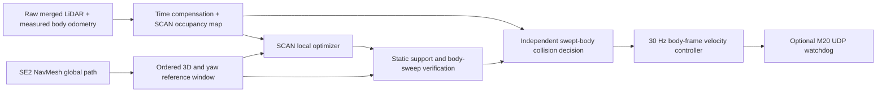

# ScanPlanner + M20

[简体中文](#简体中文)

The integration uses a fresh, pinned checkout of the **ROS 2 community port** of [SCAN-Planner](https://github.com/wuyi2121/SCAN-Planner/tree/ros2-community), commit `d0b921c9b05a6d291d144d60882b2e0e88d2c0e0`. The original Jetson `SCAN-Planner` directory and its configuration remain separate. Bag replay and stationary live-sensor integration have been validated; physical closed-loop walking and autonomous multi-floor walking have not been commissioned.

## Run

All downloads, patches, build products, logs and replay sessions stay inside `se2_nvblox_surface_shadow`:

```bash
# One-time build, on the Jetson with ROS 2 Humble and this project's dependencies.
bash /home/nvidia/scanplanner_test/se2_nvblox_surface_shadow/scanplanner_integration/install.sh

# Latest bag and its saved global map; isolated ROS domain 80; no robot UDP output.
bash /home/nvidia/scanplanner_test/se2_nvblox_surface_shadow/scanplanner_integration/start.sh
```

Use **Publish Point** in RViz to choose a floor. The start uses the current recorded **body pose and measured body height**, including yaw. During a global query, the session pauses a running bag and resumes it after the result; a bag already paused by the operator stays paused. The controller's wall-clock watchdog remains active during a pause.

Yellow: global path. Purple: current body-reference window. Cyan: accepted local path, displayed at floor height. Point cloud: current world-frame LiDAR returns. `Ctrl+C` stops only this session's processes. The existing tuning GUI and real-time reconstruction remain separately owned.

```bash
# Choose a bag/map explicitly.
bash scanplanner_integration/start.sh --bag /absolute/path/to/bag --map /absolute/path/to/map

# Headless performance run; metrics.json and samples.json are written per session.
bash scanplanner_integration/start.sh --no-rviz

# Live sensor/processing test only: no navigation route and no robot UDP output.
bash scanplanner_integration/start.sh --live --sensors-only

# Saved map + live localization, global/local planner and RViz; telemetry only.
# Start near the map recording origin when no valid current-LIO cache exists.
bash scanplanner_integration/start_live.sh

# Normal walking profile, including an explicit navigation-mode request.
bash scanplanner_integration/start_live.sh --execute --enter-navigation

# Stop the owned session from another terminal.
bash scanplanner_integration/stop.sh
```

`start_live.sh` uses the saved map with live inputs and never starts rosbag playback. It expands to `start.sh --live --localize-at-start`. The former `--map-aligned` assertion is rejected: a measured map match is required. `--execute` enables the M20 UDP sender; without it, the same receiver publishes live body height but sends only telemetry heartbeats. The robot must already be standing/in RL control, facing forward, awake, and free of a hard emergency stop. The default live `normal` profile limits total planar speed to 1.20 m/s, lateral speed to 0.40 m/s and yaw rate to 0.80 rad/s. `--speed-profile slow` restores the earlier 0.15 / 0.10 / 0.30 commissioning limits. The normal profile also raises trajectory lookahead from 0.15 to 1.30 seconds, within a speed-dependent swept collision check; changing only the speed cap would leave startup commands near 0.08 m/s. Choose a nearby goal on the same floor; physical stair trials remain unvalidated. First global queries can take about 20–30 seconds while the fast controller continues to run.

`--enter-navigation` requires `--execute`. It sends the documented Type 1101 / Command 5 request with Mode 1, at most three times, and waits for measured status to enable motion. It never stands the robot up. Mode changes reset the M20 gait to its base gait, so this convenience option is intended for the initial level-ground trial. Once navigation mode is confirmed, later operator mode changes stop velocity output and are not overridden. Normal exit sends zero velocities, then makes a best-effort request to restore the previous mode if this process changed it and the operator has not changed it again. UDP delivery cannot be guaranteed after a network failure.

The map matcher accumulates five recent scans, compensates each point using measured odometry, and checks held-out points against saved mesh surfaces. Startup needs five stable matches; tracking uses surface-normal alignment to avoid tangential floor drift. The transform cache is tied to the mesh checksum and the exact running LIO publisher GID, and is revalidated on every session. A new publisher or odometry discontinuity invalidates it. The separate `se2_scan_map` frame and `/se2_scan/aligned_odom` preserve the existing localization configuration. The C++ bridge applies fresh map transforms to raw body odometry, avoiding a Python relay in the high-frequency sensor path. An expired transform stops command authorization.

## Data flow



Live mode uses ROS domain 0 and the existing `~/.config/fastdds/eno1.xml` UDP/SHM profile; `SE2_SCAN_LIVE_DDS_PROFILE` can select another verified profile. Replay stays in localhost-only domain 80 with its separate SHM-only profile. An earlier probe accidentally used that replay profile and missed the live publishers. With the corrected profile, live LiDAR and body odometry were observed at approximately 10 Hz and 200 Hz.

The first sensor-only probe exposed missing telemetry startup and control-period outliers; that historical result is retained in the validation JSON. The complete live startup now owns the height receiver. In the final stationary live trial, an RViz goal produced a checked global path, an accepted local spline and verified turning commands. Cancellation returned commands to zero. Control ran at approximately 30 Hz; decision P95 with an active trajectory was about 34 ms, with a maximum about 51 ms. Rare overall decision outliers remain above 50 ms. Hardware output stayed disabled. These measurements support an operator-supervised low-speed first trial, not a hard real-time guarantee or a completed physical navigation trial.

The 50 ms target applies to **raw-cloud callback ingress → updated occupancy map → collision/stop decision**. It includes waiting for bracketing odometry, time compensation, point filtering, map update and collision checks. It excludes sensor acquisition/driver delay before callback ingress. Sensor age is logged separately. A fresh optimized, geometrically verified detour is a separate asynchronous result; it must not be equated with the fast stop decision.

The optimizer and global planner run outside the control process. The controller emits at 30 Hz, also while an optimizer is busy. A stopped or stalled planner, stale LiDAR/odometry, missing measured height, invalid path, cancelled goal or lost route heartbeat causes zero velocity. The optional UDP sender independently requires a fresh command and fresh robot telemetry.

`fsm.max_replan_period: 0.05` requests refresh after 0.05 seconds of ROS time during normal operation; optimizer runtime and FSM transitions also affect the achieved update rate. The original `thresh_replan` is a distance: at commissioning speeds it allowed roughly three seconds between plans, exceeding the controller's one-second trajectory lease. Periodic refresh uses measured distance to the target; each new candidate still passes geometric validation. The trajectory lease and sensor watchdogs remain unchanged, so a stalled planner still stops the robot.

## Geometry and changes to upstream

- Floor XYZ and body yaw remain in `/se2_global/path`. `/nvblox_lio/odom` must be `nvblox_odom → base_link_dog`. `MotionStatus.Height` converts floor positions to body-reference Z; the old constant estimate is not reused.
- Route progress uses ordered 3D segments, so overlapping floor XY coordinates cannot jump the route to another storey. In-place turns remain explicit. Interpolated yaw uses the shortest angular interval, rather than replacing body heading with travel tangent.
- Before execution, the route adapter merges short translation/rotation sections only when the complete replacement SE(2) body sweep passes the same saved-map checker. Each merge spans at most 2 m of original route and deviates at most 0.12 m from its XYZ polyline; rejected merges retain the original anchors. This leaves the ASA result unchanged while supplying SCAN with a continuous rolling 3 m reference where geometry permits. Adaptation runs outside the control loop, and cancellation invalidates pending work.
- The upstream path handler checks frames, cancels on an empty path and removes zero-length polynomial segments. The local optimizer is initialized from the ordered 3D window and retains its height profile; a route guide limits smoothing away from it.
- Optimized curves must pass the saved map's support and physical-body checks. Complete polygon/yaw proofs use the same semantics as the global planner; refined bits never become whole-cell permission. Rejected native curves cause a hold while SCAN retries. No adapter-generated recovery trajectory is executed. A failed enclosing swept rectangle is adaptively subdivided, and every subinterval still requires a complete native geometric proof.
- The fast guard uses the M20's 0.82 × 0.506 m rectangle, including corners. The current torso envelope extends from body Z −0.10 m to +0.40 m; static mesh verification checks the full configured height and ground support. The optimizer occupancy resolution is 0.10 m; the execution guard uses 0.05 m parents with persistent 0.01 m XY hit subcells; very tight passages can therefore stop even when the finer global model admits them. Pitch/roll-dependent swept geometry and live negative-obstacle detection are not implemented in this SE(2) integration.
- The LiDAR update runs immediately in the cloud callback. Visualization runs at 5 Hz. Point time compensation uses measured poses without extrapolation and retains one return per 4 cm world voxel. The existing verified merged NX cloud convention (`lidar_link` / `base_link_dog`, body-aligned) is required; the manual's translation table is not treated as a sensor rotation calibration.
- Returns beyond the local ray range are retained as free-space evidence. Their deduplication keys lie on a sphere just beyond the configured horizon, with separate keys from near hits; the actual measured endpoints are passed to SCAN, whose raycaster clips them as free rays. A moving obstacle is cleared by subsequent observed rays, never simply by elapsed time or by clearing the robot footprint.
- `p_hit=0.97` ensures one occupied return can cross the occupancy threshold even from the minimum free log odds. The earlier value required a second 10 Hz frame at a previously free cell, adding about 100 ms before stopping.

The fixed patch is in [`scanplanner_integration/patches/`](../scanplanner_integration/patches/), with source provenance in [`UPSTREAM.json`](../scanplanner_integration/UPSTREAM.json). The original upstream ROS 1 algorithm and this ROS 2 port are distinct releases.

## M20 wire protocol

The sender implements the supplied basic_server documentation: UDP `10.21.31.103:30000`; 16-byte `EB 91 EB 90` header; little-endian ASDU length/sequence; JSON format 1. Type 2 / Command 25 uses **m/s and rad/s** (`X`, `Y`, `Yaw`) without the old normalized-axis multipliers. It sends at 30 Hz and sends a Type 100 / Command 100 heartbeat at 2 Hz. The sender rejects planar speed above 1.20 m/s, lateral components above ±0.40 m/s or yaw rates above ±0.80 rad/s. The selected controller profile can impose lower limits.

Telemetry must report navigation usage mode, no hard emergency stop, forward direction, awake status and standing/RL motion state. Nonzero errors latch a stop until restart. The authoritative velocity topic is `/se2_scan/cmd_vel_stamped`; commands older than 120 ms are rejected by source timestamp. `/se2_scan/cmd_vel` remains available for observation. Mode changes occur only under the explicit `--enter-navigation` option described above.

The sender retains only the newest velocity message. A five-message queue at a 30 Hz source could remain stale after a short consumer stall, leaving a visible global route but zero motor commands. A localhost regression reproduces the failure and checks recovery after a 450 ms consumer stall, rejection of stale timestamps, and subsequent recovery. The 120 ms watchdog is unchanged. Telemetry-only sessions also inspect incoming commands without sending velocities; `telemetry/status.json` records received/accepted counts, rejection reasons, source age and the active stop reason.

## Validation and logs

Each run writes to `scanplanner_integration/runtime/<timestamp>/`:

| File | Purpose |
| --- | --- |
| `session.json` | Exact arguments, child processes, completion/failure and hardware-output mode |
| `metrics.json` | P50/P95/P99/max, frame replacements/drops, active-trajectory timing, control frequency and slow periods |
| `samples.json` | Per-frame and per-command samples for reproducible analysis |
| `bridge.log`, `optimizer.log`, `route.log` | Sensor rejection, local optimization and geometry decisions |
| `global.log`, `player.log`, `rviz.log` | Global query, playback and display lifecycle |
| `telemetry/status.json` | M20 usage mode, command acceptance/rejection counts, stop reason and UDP packet counts |

A recorded bag supplies recorded odometry, so commands cannot change its route. If it walks away from the selected planned corridor, the bridge stops and reports `replan_required`. This is expected in open-loop replay, not a closed-loop navigation success. Performance of a complete verified detour is reported separately from the fast collision decision. See [`scanplanner-validation.json`](scanplanner-validation.json) for measured results and test scope.

```bash
python -m unittest discover -s scanplanner_integration/tests -v
# On Jetson, after sourcing ROS and scanplanner_ws/install/setup.bash:
ROS_DOMAIN_ID=81 ROS_LOCALHOST_ONLY=1 python scanplanner_integration/tests/ros_guard.py --output scanplanner_integration/runtime/guard_test
ROS_DOMAIN_ID=81 ROS_LOCALHOST_ONLY=1 python scanplanner_integration/tests/udp_loopback.py
ROS_DOMAIN_ID=81 ROS_LOCALHOST_ONLY=1 python scanplanner_integration/tests/udp_backlog.py
```

## 简体中文

已在项目内部下载并部署独立的 ScanPlanner ROS 2 源码，不复用或改写旧 `SCAN-Planner` 工作区。默认启动命令：

```bash
bash /home/nvidia/scanplanner_test/se2_nvblox_surface_shadow/scanplanner_integration/start.sh
```

默认加载最新 bag 及与它绑定的全局图，在独立 ROS 域 80 中运行。RViz 使用 **Publish Point** 选目标楼层，起点来自当前包内机身位姿和实测机身高度。全局规划期间自动暂停正在播放的 bag，得到结果后恢复；控制始终受墙钟超时保护。黄色为全局路线，紫色为机身参考窗口，青色为通过校验的局部轨迹。默认不向机器狗发送运动指令，`Ctrl+C` 只关闭本次会话。

加上 `--live --sensors-only` 仍可单独测试实时点云。完整实时入口为 `start_live.sh`：只读取建好的地图，输入全部来自实时雷达、SuperLIO 和 M20 状态，不播放 bag。已修复机身高度接收器漏启，并加入真实点云配准；变换绑定地图校验和及本次 LIO 发布者，重启会重新验证，不能用 `--map-aligned` 声明绕过。它使用独立的 `se2_scan_map` 坐标系，不覆盖原有定位或传感器 TF。

实时正常速度启动命令：

```bash
bash /home/nvidia/scanplanner_test/se2_nvblox_surface_shadow/scanplanner_integration/start_live.sh --execute --enter-navigation
```

机器人须已起立或进入 RL 控制。此命令显式请求切换导航模式，收到状态确认后才允许执行 RViz 目标；切换模式会恢复基础步态。默认 `normal` 档上限为平面合速度 1.20 m/s、侧向 0.40 m/s、转向 0.80 rad/s。追加 `--speed-profile slow` 可恢复原来的 0.15 / 0.10 / 0.30 低速档。正常档还将轨迹前视时间从 0.15 秒改为 0.50 秒，碰撞前视时间随速度上限增大；只提高限速会让零初速轨迹的起步指令仍停留在约 0.08 m/s。首条全局路径约需 20–30 秒。`Ctrl+C` 或 `stop.sh` 关闭本次会话；程序先发零速度，再尽力恢复由它切换前的使用模式。操作员中途切换模式时，程序不会自动抢回控制。

最新静止实机测试已验证地图定位、实测高度、全局目标、局部轨迹、转向控制输出和取消停车，硬件端始终为只读状态。控制约 30 Hz；活动轨迹下雷达回调至避障决策 P95 约 34 ms、最大约 51 ms，仍有少量超过 50 ms 的峰值。初期探测中出现过启动长周期，旧结果保留在验证记录中。实际行走闭环、极窄通道和楼梯执行仍需现场试验，不能把静止输出指令当成已经完成导航。

50 ms 指标明确测量“原始雷达点云进入回调 → 地图更新 → 碰撞/停车决策”。传感器采集至进入回调的延迟单独记录；完整绕障轨迹的优化与几何校验耗时也单独统计，不能用停车延迟代替。控制输出设为 30 Hz，并记录实际周期及超过 50 ms 的次数。

跨楼层的高度、路线顺序和指定朝向会保留。局部平滑不能跨过全局图中的支撑缺口；不满足校验时停车，等待原生 SCAN 重新生成可验证轨迹。没有可用路线、数据过期、定位失效或取消目标时输出零速度。局部 10 cm 占据栅格仍可能比全局细粒度通行图保守，实机极窄通道和跨楼层闭环行走尚未验收。

M20 接口按文档使用真实速度单位，发送频率 30 Hz，没有沿用旧控制器的倍乘系数。速度携带来源时间戳，超过 120 ms 的旧指令不能刷新看门狗。断流、定位变换过期、缺少机身高度、取消目标或校验失败时停车。若当前机身与保存地图中的障碍相交，会拒绝起点；本次现场确认过一处小型孤立 Mesh，未通过删除障碍或绕过碰撞检查强行放行。

已修复“黄色路径存在但机器狗不动”的指令积压问题：发送端原先缓存 5 帧，短暂卡顿后会持续消费过期速度，触发超时停车；现在只保留最新一帧，120 ms 看门狗保持不变。回环测试覆盖暂停接收进程 450 ms 后恢复、拒绝过期指令、重新接收新指令。只读会话同样检查速度接收链路，且不发送运动包。`telemetry/status.json` 新增接收/接受数量、拒收原因、时间戳延迟、停车原因及实际 UDP 发送数量。

同时修复低速规划更新与轨迹有效期不匹配的问题：原 `thresh_replan` 是距离阈值，低速时约 3 秒才更新一次，而控制器要求轨迹在 1 秒内更新。现设 `fsm.max_replan_period: 0.05`，正常运行中在 0.05 秒 ROS 时间后请求刷新未完成路线；实际更新频率还受优化耗时和状态机切换影响，以实测位置判断是否仍未到达；每条新轨迹继续做几何校验，1 秒轨迹有效期和传感器超时保护保持不变。

日志与数据均保存在 `scanplanner_integration/runtime/`，源码和构建结果位于 `scanplanner_ws/`，不会在项目同级新增文件夹。详细实测结果见 [`scanplanner-validation.json`](scanplanner-validation.json)。

## Historical debugging notes

**October 10 update:** the handcrafted fallback/recovery mechanisms described below have been removed. The current chain accepts native SCAN splines only, plus mandatory rotations already specified by the certified global route. Historical tests are retained as evidence of previous versions, not current acceptance.

**10 月 10 日更新：** 下述历史记录中的人为保底、先转再前进恢复动作已移除。当前只接受原生 SCAN 样条以及全局路线原本要求且经过校验的必要转向。历史数据不代表当前版本验收。

October 8, 2026: a separate startup stall was traced to the first in-place turn. The active standard/basic gait (`0x1001`) accepts nonzero Cmd=25 yaw rates from 0.5 rad/s, while proportional control requested about 0.34 rad/s. Live sessions now use `min_in_place_yaw_speed: 0.5` only after the pure-rotation sweep is certified and the live collision/freshness checks pass. The turn stops within 0.10 rad, inside the route's 0.12 rad heading tolerance. Translation commands are unchanged. If the configured yaw cap is below the required minimum (including the former `slow` profile), the controller holds with `turn_limit_below_gait_minimum` instead of exceeding the cap. An isolated ROS test with a 0.5 rad/s actuator dead zone covers both turn directions, convergence, obstacle stop, stale pose and cancellation; it is not a physical walking acceptance test.

2026 年 10 月 8 日另定位到首次原地转向停滞：当前标准基础步态 `0x1001` 的 Cmd=25 非零转向有效速度从 0.5 rad/s 起，原比例控制仅输出约 0.34 rad/s。现仅对通过机身旋转扫掠校验、实时避障及数据新鲜度检查的原地转向设置 0.5 rad/s 下限，并在误差进入 0.10 rad 后归零，满足路线推进的 0.12 rad 容差。没有在 UDP 发送端放大速度，也没有改变平移控制。若用户配置的转向上限低于有效下限（包括旧 `slow` 档），会保持停车并报告 `turn_limit_below_gait_minimum`。含执行器速度死区的独立 ROS 测试覆盖正反转、收敛、障碍停车、位姿过期及取消；实机完整行走仍需验证。

On October 8, a second stall was traced to a 0.15 m execution window within an 8.1 m ASA path. A small yaw step ended the window; SCAN rejects targets closer than 0.20 m, while route advancement requires 0.12 m. Ten failed attempts caused the optimizer to wait for another target. The geometry-checked adapter reduced this captured path from 93 to 33 execution poses and restored a 1.5 m window. Required rotations and height transitions remain when a combined motion cannot be certified. Spline proximity now uses 3D distance to reference segments, so sparse anchors do not cause false rejection. The checked fallback selects the farthest feasible forward sample within 0.65 m instead of repeatedly stopping at the first nearby anchor (also observed in the September 30 stall).

The stationary live test (`runtime/20261008_123804`, hardware output disabled) planned a fresh 90-pose route, adapted it to 32 poses, accepted 63 local paths and produced nonzero commands in 93.8% of the 20-second observation. Median active forward output was 0.218 m/s, maximum 0.279 m/s; cancellation returned output to zero. SCAN kept replanning without the captured `Close to goal` failure. All 22 Python integration tests passed. Freshness holds still occurred; telemetry-only command output is not a physical walking acceptance test. There is no automatic global recovery when no certified connector exists, and mandatory short stops/final approach still retain the optimizer's near-target limitation.

10 月 8 日再次停滞的直接原因是：8.1 米全局路线被小幅原地转向切成 15 厘米的执行段；SCAN 对不足 20 厘米的目标返回 `Close to goal`，但接口要到 12 厘米内才推进，累计失败 10 次后退出。现对执行参考做带几何校验的合并：单次原路径跨度不超过 2 米、XYZ 偏离不超过 12 厘米，并验证整段机身及朝向扫掠。原 ASA 路线不变，无法通过合并校验的转向和高度锚点保留。捕获路线从 93 点变为 33 点，恢复 1.5 米滚动前视段；轨迹偏离检查改用到线段的三维距离；保底轨迹在 0.65 米范围内选择最远可验证前向位置，避免反复追逐厘米级近点。

关闭硬件输出的实时联调中，新路线 90 点合并为 32 点，20 秒收到 63 条通过校验的局部轨迹，93.8% 控制周期有非零指令，前进中位数 0.218 m/s、最大 0.279 m/s，取消后归零，未重现上述连续失败。22 项 Python 测试通过。测试仍有数据新鲜度触发的短暂停车，尚不能认定实机已走完整条路线。没有可验证连接时仍停车，未加入自动全局恢复；无法合并的必要短停段和最终接近仍受优化器近目标限制。

The next physical trial exposed a remaining actuator mismatch: the holonomic fallback requested about X=0.08 m/s, Y=0.20 m/s and yaw=0.16 rad/s, below all three documented nonzero minima of the active `0x1001` gait. Its replacement uses a certified turn/forward maneuver: at most 0.65 m from the measured body, within 0.35 m of the first 0.8 m of the ordered local reference, with floor-height changes limited to 0.15 m. Both the complete in-place rotation and straight translation must pass the saved-map checker. The bridge checks their full live swept volume, turns at 0.5–0.6 rad/s until within 0.05 rad, then drives forward at 0.20–0.25 m/s with no lateral command. It stops within 0.10 m of the target. The certificate is tied to the reference timestamp, renewed from current measured poses, and expires after 0.5 s; freshness checks, cancellation and configured speed caps still apply. A profile below the required minimum holds instead of silently increasing its cap. No valid connector means a reported hold, never a blind speed increase.

The captured stalled pose admits a 0.45 m forward connector with these full geometric checks (about 66 ms search). `ros_maneuver_guard.py` exercises the compiled bridge with actuator dead zones in an isolated ROS domain: both turn directions converge, forward motion reaches the target, and obstacle/cancellation/stale-pose/expired-certificate/wrong-reference cases stop. Existing spline and pure-turn regressions also pass. This proves the simulated control transition, not physical completion of the route. A restart also exposed an initial registration mismatch between point fitting and plane tracking; initialization now finishes plane fitting before the unchanged quality and five-stable-match checks authorize a pose.

随后的实机试验又暴露出执行死区：保底轨迹输出约 X=0.08 m/s、Y=0.20 m/s、Yaw=0.16 rad/s，均低于当前基础步态的有效非零范围。现将这类保底纠偏改成经过完整校验的“先转、再前进”：搜索只在当前顺序参考的局部邻域内进行；固定短段目标，持续从实测位姿重新校验旋转与直行。转向误差进入 0.05 rad 后，才以前进 0.20–0.25 m/s 执行，侧移为零，到目标 0.10 米内停止。实时雷达检查整段动作，校验证书绑定当前参考且 0.5 秒过期；没有有效连接会明确停车。模拟测试已覆盖带死区的正反转、前进到达以及障碍、过期、取消等停车条件，实机完整路线仍待验收。重启后的首次地图匹配也改为先完成与跟踪一致的平面拟合，再经过原有质量与五次稳定检查。

Stationary live validation (`runtime/20261008_130032`) retained one recovery target through the observation and requested exactly 0.5 rad/s for active turns. Hardware output stayed disabled; therefore this run intentionally did not transition into forward motion. Cancellation produced zero output. The full session measured 30.00 Hz control, ingress-to-decision P95 27.3 ms and maximum 49.9 ms; these are observed samples, not a worst-case timing guarantee. All 24 Python integration tests passed, including initialization-to-tracking consistency. The separate simulated actuator test covers the turn-to-forward transition.

实时只读联调 `20261008_130032` 中，短段目标保持固定，有效转向输出为 0.5 rad/s，取消归零。电机输出关闭，因此这次静止联调没有进入前进阶段；转向后前进由独立闭环模拟验证。整场测得控制 30.00 Hz，点云回调至避障决策 P95 27.3 ms、最大 49.9 ms；这些是本轮样本结果。24 项 Python 测试通过，包含首次匹配与后续跟踪的一致性。

The later `20261008_144316` session was held by live occupancy in all 499 active-path frames and emitted no nonzero motor commands. Two occupied cells about 0.67 m ahead remained after the close returns disappeared. In the captured scan, 33 and 110 rays to endpoints beyond 4 m crossed those cells, but the bridge discarded all returns beyond 4 m before SCAN could use them to clear free space. The preprocessing range cutoff has been removed; far-ray deduplication limits processing cost while keeping near-hit evidence separate. `ros_guard.py` reproduces the old permanent stop and checks clearing by far returns, retention without new observations, continued stopping with a visible obstacle, stale inputs and cancellation. Safety geometry and occupancy thresholds are unchanged. Evidence is saved under `runtime/stop_20261008_1453/`.

`20261008_144316` 的停车由残留占据格触发：499 帧有效短段检查全部阻挡，未发出非零电机指令。捕获点云中，前方约 0.67 米的两个格子已有 33 条、110 条远距离射线穿过，但 4 米外的回波被预处理丢弃，空闲证据无法进入地图。现保留这些实测射线，由 SCAN 在配置的量程处截断并更新为空闲；远射线单独降采样，不能挤掉近处障碍回波。回归测试覆盖旧版本的永久阻挡、远回波清除、无新观测时保留障碍、可见障碍仍停车、数据过期和取消。未缩小机身碰撞范围、降低占据阈值或按时间强制清空地图。

The same regression exposed missed cells in SCAN's ray traversal. Traversal now uses the measured fractional endpoint direction, handles negative boundaries and simultaneous axis crossings, and continues beyond previously visited cells without adding duplicate per-frame misses. Sharing an endpoint voxel no longer discards a distinct ray. An independent segment/AABB test passes 1,007 cases; the original implementation fails it. The compiled ROS guard regression passes clearing, obstacle retention, stale-pose/alignment and cancellation checks. Its decision latency was P95 17.8 ms, maximum 72.4 ms; this synthetic result is not a worst-case timing guarantee or physical navigation acceptance.

同一回归测试还发现射线遍历会漏格：原实现使用整数格索引差代替真实端点方向，并在遇到已访问格或相同终点格时提前丢弃后续射线。现按真实端点逐格遍历，处理负向边界和同时跨轴，同一帧不重复累计空闲证据。独立线段与体素相交测试通过 1,007 个样例，原实现不能通过；编译后的 ROS 回归通过清除、保留真实障碍、位姿/配准过期和取消停车检查。合成数据测得决策 P95 17.8 ms、最大 72.4 ms，尚不能保证所有周期均低于 50 ms，也不代表实机行走验收完成。

RViz now displays SCAN's local occupied voxels (`/se2_scan/grid_map/occupancy`) as orange 10 cm boxes. Inflated occupancy is available as an optional red layer; raw lidar is disabled by default. These are the optimizer's actual occupancy layers, refreshed without display accumulation, rather than raw points drawn as cubes.

RViz 默认改为显示 ScanPlanner 的局部占据体素：橙色方块边长 10 cm，数据来自优化器实际占据地图 `/se2_scan/grid_map/occupancy`。红色膨胀体素可按需勾选，原始雷达点云默认关闭；显示使用当前帧替换，不在 RViz 中额外累积历史点。

Live session `20261008_152346` verified the voxel display on the Jetson desktop and received 16 occupancy updates in five seconds, with about 4,900 occupied cells. Hardware output was disabled throughout. The prior distant goal returned no global path; a nearby goal produced a 0.7 m global route and one verified local path, but did not sustain commands and later held for stale trajectory/body-height inputs. The live regression therefore did not pass. Control averaged 30.00 Hz; active-path ingress-to-decision P95 was 59.2 ms, maximum 59.8 ms over only ten active frames. The full-session maximum was 228 ms and included startup and concurrent isolated testing. Neither the 50 ms target nor physical walking is accepted by this run.

实时会话 `20261008_152346` 已在 Jetson 桌面确认体素显示，5 秒收到 16 帧占据地图、约 4,900 格；全程关闭电机输出。原远处目标返回无全局路径，近处目标得到 0.7 米全局路线和一条已校验局部轨迹，但未持续输出控制，之后因轨迹及机身位姿/高度状态过期而停车，实机静止联调未通过。控制平均 30.00 Hz；仅 10 帧有效轨迹样本中的决策 P95 为 59.2 ms、最大 59.8 ms。整场含启动和同时运行的隔离测试，最大延迟 228 ms。本轮不能认定已达到 50 ms 指标或完成实机行走修复。

## October 8: live obstacle boundary and execution fixes

The active SCAN horizon is now 3 m. The reference initializer ends at the actual collision-adjusted local target; SCAN's existing A* provides a detour guide when the saved reference intersects current occupancy. A stationary emergency-stop spline is not a valid progress trajectory. A fresh optimizer failure for the exact current reference can trigger a separately checked short maneuver; a silent optimizer cannot renew that permission. Maneuvers retain their fixed target across nearby reference-window advancement and recertify the bearing from the measured body pose. The candidate search includes 15/20/25 cm lengths and 3-degree headings. These are bounded local execution connectors, not a replacement global planner.

The immediate collision map uses 5 cm parent voxels over a 4 × 4 × 2 m rolling volume and a 2 m ray range; the optimizer retains its 8 × 8 × 4 m map and 4 m sampling horizon. Before downsampling, **all** measured near-body hits populate persistent 1 cm XY subcells inside observed parent voxels. The vertical extent remains the parent's 5 cm. Subcell hits are retained while the parent is occupied and are removed only when the original ray evidence clears that parent, or the parent leaves the rolling map. An already occupied cell without a complete hit history retains its whole coarse volume. This avoids treating empty portions of a coarse occupied voxel as a measured surface without discarding older unseen obstacles. `/se2_scan/guard/collision_occupancy` carries the actual cell size per point; the route validator uses those same dimensions. The bridge bounds the complete swept rectangle over each motion interval and subdivides ambiguous intervals; it does not authorize a path from endpoint samples alone.

Saved-mesh support validation now includes clipped, slope-compatible triangle extrema within one vertical quantum of the sampled floor. Previously, a missed 3 mm ground vertex could become a false body collision even though the sampled support floor was valid. The bound is fixed before examining triangles, so successive triangles cannot raise it repeatedly. Higher bumps, walls, low roofs and support gaps remain rejected.

Robot telemetry gaps were captured at the Jetson network interface, including about 2.1 s without MotionStatus and about 3.0 s without BasicStatus during a 20 s capture; packet reassembly and decoding were checked separately. The UDP sender keeps the existing freshness limits and writes `telemetry/health.jsonl` with received-message counts, maximum gaps and stop reasons. This evidence locates the gap before application decoding; it does not yet distinguish the robot server from the network path.

Physical trials have progressed beyond the initial stall but have not yet completed the selected goal. **The strict 20 Hz / <50 ms requirement is not yet accepted:** average control frequency alone is insufficient, and observed timing outliers still exceed those deadlines. Metrics distinguish geometric candidates from actually published splines/maneuvers; a discarded or replacement maneuver is excluded from the cloud-to-verified-SCAN-spline statistic.

当前 SCAN 前视长度为 3 米；局部参考在实际调整后的终点处截断，遇到实时障碍时使用 SCAN 自带 A* 引导绕行。静止急停样条不再被当作有效前进轨迹；只有当前参考对应的、仍在持续上报的优化器明确失败，才允许重新校验短段动作。执行目标在同一路线的滚动参考更新中尽量保持固定，并从实测位姿重新验证。候选补齐 15/20/25 cm 距离与 3° 朝向采样。

近身碰撞图采用 5 cm 父格，在其中保留所有原始近身回波的 1 cm 平面子格；垂向仍保持 5 cm。父格未被原有射线证据清除时，历史子格不能因“这一帧没看到”而消失。没有完整观测历史的旧占据格保留整个粗格。实际判定格子的尺寸经 `/se2_scan/guard/collision_occupancy` 同步给路线验证器。机身尺寸没有缩小，也没有对已经相交的格子豁免碰撞；控制器验证连续运动的包络，不能只凭终点空闲放行。

地图几何校验另修复了支撑采样漏掉毫米级三角形顶点的问题；较高凸起、立面、低顶及支撑缺口的回归仍要求停车。网络抓包确认机身状态上报在到达应用解码前已有间隙；持续日志位于 `telemetry/health.jsonl`，未放宽通信看门狗。实机完整到达及严格 20 Hz / 50 ms 指标仍以实际测试结果验收，不能用平均频率或已发速度指令代替。


### 2026-10-10：启动后局部体素为空 / Empty local voxels after startup

实时雷达与原始里程计正常、占据话题点数为零时，先检查运行目录中的 `localization/status.json`。本次原因是新里程计坐标系与保存地图存在约 5° 的横滚/俯仰差；旧 XYZ + yaw 配准无法校正倾斜，定位质量检查阻断了地图坐标系中的点云和体素更新。

定位现使用完整刚体配准与六自由度表面跟踪，并发布完整四元数。初始倾斜校正限定在 10° 内；独立留出点质量验证、歧义拒绝、表面约束检查、五次稳定匹配及定位过期停车仍然生效。旧版仅 yaw 的缓存不会作为完整姿态缓存加载。当前扫描离线匹配率从约 56% 提高到 90.6%，Jetson 独立实时验证达到稳定 tracking（约 88–89%）；未放宽匹配阈值。

The local voxel streams were empty because map localization could not correct a roughly five-degree roll/pitch difference between the new odometry frame and the saved map. Full rigid registration and six-DoF surface tracking now publish the complete orientation. Initialization remains bounded to a ten-degree tilt correction, with held-out quality checks, ambiguity and degeneracy rejection, five stable matches, and stale-localization stops retained. This change does not resolve the previously observed local obstacle-planning stall or establish the strict 50 ms planning deadline.

部署验证：会话 `20261010_135753` 已进入 tracking；10 秒采样中 SCAN 占据话题收到 41 帧、末帧 4,504 个体素，近身检查占据话题收到 48 帧、末帧 4,165 个体素。已通过桌面截图确认 RViz 橙色体素显示恢复。Python 回归共 40 项，其中 32 项通过、8 项因本机未安装 ROS 消息而跳过；另完成 Jetson 实时独立定位验证。本次没有发送导航目标。


## October 10: native trajectory chain and speed limits

The adapter no longer generates fallback splines or turn/forward recovery maneuvers, and heading mismatch no longer replaces a native trajectory. The optimizer retains the active reference after repeated failure and retries from measured odometry, including measured velocity, when fresh sensor data is available. Cancellation clears the retained reference. Every native spline still passes saved-map support/body validation and live swept-body collision checks.

当前已删除人为生成的保底样条和先转再前进恢复动作；原生样条不再因朝向差异而被替换。优化器连续失败后保留当前目标，用实测位置和速度重试；取消目标会清除保留参考。全局支撑/机身几何校验、实时连续扫掠、传感器和通信超时停车继续生效。

The normal live profile caps planar speed at 1.2 m/s and yaw rate at 0.8 rad/s, with a 0.4 m/s lateral component cap. Limits apply to the optimizer, controller and outgoing protocol packets. The immediate collision volume is 6 × 6 × 2 m with 3 m rays; the optimizer retains its 4 m sampling range. These are caps, not guaranteed achieved speeds. No gait change or small-command amplification is applied.

默认实时档为平面合速度上限 1.2 m/s、角速度上限 0.8 rad/s、侧向分量上限 0.4 m/s，优化器、控制器及协议出口同步约束。近身碰撞图扩大为 6 × 6 × 2 m、射线范围 3 m；碰撞前视随配置速度延长。没有切换步态或将小指令强行放大，实际速度由轨迹及校验结果决定。

Isolated full-chain test `runtime/20261010_native_test4` (before the speed-cap increase) produced 165 verified native trajectories and 349 nonzero control samples on the clear segment, zero settled commands under obstruction, then 105 new verified native trajectories and 147 commands after measured free rays cleared the obstruction, without a new goal. Cancellation produced zero commands. This test starts no robot UDP sender. It establishes retry behavior, not physical goal completion or a strict 50 ms deadline.

Raising the speed cap exposed an acceleration-infeasible short-guide initializer. Reference sample timing now also respects the rest-to-rest triangular-profile average speed, `0.5 * sqrt(max_acc * arc_length)`, while retaining measured boundary derivatives and the native dynamic feasibility check. This changes time allocation, not the route or obstacle checks.

提速后补测发现短参考段时间分配过短。现按段长与加速度约束其初始化平均速度，同时保留实测边界速度、加速度及原生动态可行性检查；没有改成手工动作或放宽碰撞条件。

Latest-profile regression `runtime/20261010_native_speed_test2` passed after the time-allocation fix: 172 verified native splines on the clear segment, zero settled commands under obstruction, 108 new verified native splines after free-space observation without a new goal, and zero commands after cancellation. Jetson Python tests: 30 passed. Updated collision-map component test: passed, ingress-to-decision P95 19.9 ms / max 85.0 ms; this does not meet a strict <50 ms bound.

A physical native-only trial moved approximately 0.22 m before repeated static sweep rejection. The captured failure was one small rotating/translating interval near x=2.7 m: its endpoint poses were valid and all four subdivided swept intervals were valid. `StaticGuard` now subdivides rejected intervals, requiring a complete native swept proof for every leaf; it never accepts endpoint clearance alone. The captured full spline passes in about 8 ms on the development host. Added real-geometry regressions retain rejection of a wall or support gap between clear endpoints. Physical goal completion remains under test.

The native detour adapter no longer rejects a curve solely for exceeding a 0.65 m band around the global path; complete saved-map and live geometry checks remain authoritative. Measured route departure is bounded by the 3 m local planning horizon. Native spline refinement now resets its collision result per attempt and performs up to three attempts, fixing the original loop that could never retry.

Firmware compatibility probe: this robot returns `57347 / Unsupported protocol type` for Type 1002, Command 4 and 6 query requests, despite the supplied guide describing UDP query registration. Those experimental requests were removed; heartbeat-based reception remains active. Errors still latch a stop, and `telemetry/status.json` now records their exact type, command, code and message. A protocol acknowledgment without actual BasicStatus or MotionStatus.Height no longer refreshes the corresponding watchdog. Current Jetson Python regression: 35 passed. The localhost sender test exercises 1.2 m/s and 0.8 rad/s at approximately 30 Hz, stale-command stopping and mode restoration.

实机第 4 轮（`20261010_151344/native_drive4.json`）由原生 SCAN 前进约 1.06 m，尚未到达目标；拐角未来段仍可能被保存 Mesh 的局部凸起拒绝，机身状态断报仍存在。该结果不是全路线通行验收。没有启用不受支持的状态查询，也没有放宽错误或超时停车。


Reference validation now stores the measured body height used when each reference is issued. A later height update no longer shifts that existing trajectory relative to the saved floor; the measured start pose still uses the current height. Complete same-floor/yaw polygon certificates can be combined only when their geometric union covers the entire motion segment. Gaps and missing orientation certificates remain rejected. Jetson regression: 37 passed. The captured drive-4 candidate passes all 43 intervals after these corrections (16.5 ms on the development host). A different drive-5 snapshot still fails near a corner, despite reducing 69 ASA poses to 7 execution poses and an unsuccessful higher guide-weight comparison. Waypoint density alone does not explain the remaining stall.

参考轨迹现在保存生成时使用的机身高度；后续高度更新不会错误平移旧轨迹的地面高度，实际起点仍按最新实测高度校验。同一地面高度与朝向范围内，相邻已完整认证区域的并集必须连续覆盖整段运动才可放行，不能跨越缺口或缺少朝向证明的区域。Jetson 37 项回归通过；第 4 轮抓到的轨迹全部 43 段通过。第 5 轮另一条参考路线仍存在拐角校验失败，尚未认定完整到达目标。

The native reference initializer now trims progress from the beginning of the current ordered 3-D window on every replan. Previously it prepended measured position to the entire old reference, reintroducing a point already behind the body and creating a short reverse bend. Forward bends and landings remain, and the resulting native spline still requires full validation. A standalone C++ regression covers progress, corners, folded paths and distinct floors. The isolated native-chain regression passed 172 verified clear trajectories, zero settled obstacle commands, 105 resumed trajectories after observed clearing, and zero commands after cancellation.

One-quantum floor transitions additionally require explicit saved NavMesh portals, allowed yaw, continuous region coverage, and at most one vertical quantum of height spread. They cannot connect a gap or another floor merely through XY overlap. With that change, all 44 intervals of the captured drive-6 spline pass on the development host; the different drive-5 corner still fails. The drive-6 physical trial before the native prefix fix advanced only 0.133 m and was cancelled after stalling. It did not reach the goal.

Latest snapshot regression `20261010_snapshot6_portal` passed: the original 77-pose ASA path adapted to 7 execution poses; 97 verified native trajectories and 323 nonzero control samples were produced. Jetson Python regression: 38 passed.

Physical follow-up `20261010_155706/native_drive7.json` did **not** reach the goal. It reused the original ASA route, advanced 0.156 m, then automatically cancelled after stalling; the session was stopped. The optimizer reported 618 successes, but saved-map validation accepted only 16 trajectories. The captured candidate includes invalid intervals in the near-body connection and around the future corner, including yaw-restricted cells. This remains an inconsistency between native curve generation and the global SE(2) feasible corridor, not evidence that the entire route works. This was the baseline before the subsequent SE(2) curve-cost integration.

控制输出平均 30.01 Hz、最大周期 45.84 ms；协议发送器另记录了约 90 ms 的最长发送间隔。雷达输入至决策 P95 102.3 ms、最大 197.6 ms；候选几何验证 P95 232.4 ms。严格的端到端 20 Hz / 小于 50 ms 要求仍未达到，不能只依据控制线程平均频率验收。机身状态断报仍可触发正常超时停车。


## Native curve / SE(2) corridor consistency

The native optimizer and live checker now derive body heading from the same ordered 3-D reference, rather than treating sideways trajectory tangent as body yaw. Native rebound and time refinement both constrain the actual cubic curve to its guide. The route adapter publishes a timestamp-matched SE(2) corridor containing proven polygons and feasible pose witnesses; refined cells are never promoted to full-cell permission. Native planning waits when the corresponding corridor is missing. Corridor distance is evaluated at the reference support layer, within one map vertical quantum, rather than at smoothed body altitude with a step-height-wide tolerance. A 1 cm interior preference is an optimization cost only; it changes neither certified map permissions nor the final full-body sweep.

Saved-map validation similarly selects the reference ground layer while checking measured body-height consistency and limiting vertical departure. The final native mesh sweep and live obstacle stop remain mandatory. The bridge skips its unused cylinder-inflation buffer; raw occupancy, retained obstacle evidence and rectangular swept-body checking remain active, and requesting disabled inflated occupancy fails closed. The optimizer's inflation remains enabled.

原生优化器和实时检查现使用相同的参考机身朝向，避免把侧移方向误当成机身朝向。实际三次样条在重弹优化和时间细化阶段均受参考曲线及 SE(2) 可行区域约束；细化格子只提供已验证的姿态点，不扩大为整格许可。约束与参考路线按时间戳配对，缺少匹配约束时等待。地面层按参考路线选择，不再因机身高度平滑而误用旁边高差数厘米的区域。优化器的边界内部偏好不改变地图许可或最终碰撞条件。

抓取的失败曲线在离线代价优化中已全部通过原有几何检查，但这不等于原生全链路或实机完整到达已经验收。最终测试结果及延迟以对应 runtime 目录的 JSON 为准；未添加恢复动作。

Jetson regression `20261010_snapshot7_layer` replayed the drive-7 raw scan and original ASA route: 39 native splines verified and 307 nonzero controller samples in the trial interval, versus zero verified splines before the layer correction. `20261010_native_corridor_chain2` passed: 167 verified clear trajectories, zero settled commands under obstruction, 108 resumed trajectories after observed clearing without a new goal, and zero commands after cancellation. The component guard passed new-obstacle stopping, unseen-obstacle retention, far-ray clearing, stale-odometry stopping and cancellation. Its obstacle-to-zero observation was 37.8 ms; its worst ingress-to-decision sample was 96.5 ms. These are isolated tests, not physical completion.

In the captured full-density scene, the unindexed corridor implementation measured control mean 30.00 Hz / maximum period 34.1 ms, ingress-to-decision P95 85.2 ms, native optimization P95 209.7 ms, and cloud-to-published-verified-trajectory P95 509.1 ms. The strict latency target remains unmet. A later exact bounding-box index preserves the exhaustive distance calculation; a 1,000-query regression checks yaw masks, layers and nearest distances. The indexed Jetson run `20261010_snapshot7_index` passed with 106 verified splines in the trial interval. Native optimizer P95 fell to 33.7 ms (maximum 41.9 ms), with a 30.00 Hz controller; ingress-to-decision P95 remained 82.3 ms and cloud-to-published-verified-trajectory P95 293.9 ms. Thus the full latency requirement remains unmet.

实机重启会话 `20261010_175401` 未通过定位初始化：多个候选位置相差约 0.7 m，且匹配质量不足。没有为继续试跑而强制指定定位或降低门槛；会话已停止。只读候选诊断保存于该会话的 `alignment_probe/candidates.json`，待确认机器人是否移动后再继续同一目标实测。

现场随后确认已回到录包起点、朝向相同。对同一实时数据改用录包起点搜索后，结构点匹配率达到 90.9%，定位通过原有门槛。会话 `20261010_180241` 使用默认录包起点搜索重新启动，继续同一终点的实机验收。


The next physical trial (`20261010_180241/native_drive8.json`) sent zero nonzero velocity packets: native time refinement left an acceleration-infeasible curve and discarded it. Time allocation now rechecks the refined derivatives and permits up to three native retiming/refinement attempts, preserving measured boundary derivatives and the final dynamic check. Adaptive saved-map subdivision now uses the same full polygon/portal-or-mesh proof as its parent. Previously its endpoint gate and children used only the conservative mesh fallback, rejecting already-certified poses. The new regression accepts consecutive certified one-quantum transitions but rejects the same motion when the required portals are removed. All 42 Python tests passed on Jetson.

The captured start scene (`20261010_snapshot8_certificates`) then produced 76 verified native splines and 292 nonzero controller samples. With the former 0.5 s lookahead, its forward command was only 0.063 m/s. The normal tracking profile now uses 1.3 s lookahead within the existing 2.75 s speed-dependent collision sweep. No minimum translation clamp, extra escape trajectory or gait change is introduced; output remains the native spline derivative plus tracking feedback and is capped at 1.2 m/s / 0.8 rad/s. The constructor rejects a lookahead outside the checked horizon.

Native L-BFGS output is now copied back from the returned variable vector after every solve. On a failed line search, the solver restores that vector, whereas cost callbacks had left the control-point matrix at the rejected trial. Subsequent geometry and dynamics checks now examine the actual returned curve. Captured-start regression `20261010_snapshot8_solver_return` passed with 76 verified native splines and 304 nonzero controller samples. The 1.3 s lookahead component test `20261010_tracking_guard` passed obstacle stopping, obstacle retention/clearing, stale odometry and cancellation; its observed obstacle-to-zero time was 69.1 ms, so this is not a strict 50 ms acceptance.

A native L-BFGS line-search rounding failure now sends the returned finite iterate through the existing collision, retiming and dynamic feasibility checks; a solver error alone does not certify a trajectory. The drive-9 captured-scene regression (`20261010_snapshot9_stalled_iterate`) produced 95 verified trajectories. Physical trial `20261010_181950/native_drive10.json` subsequently moved about 0.687 m and sent 57 nonzero velocity packets, then stalled in native replanning. It did not reach the goal. The same trial observed robot status gaps and a maximum outgoing send period of 74.6 ms; continuous 20 Hz operation and the strict 50 ms latency requirement are not established.

该停点的 A* 绕行参考后半段走出了保存地图可通行区域；固定为零朝向仍不能通过。隔离复现 `20261010_snapshot10_baseline` 生成 83 条原生候选曲线，但全部被保存地图扫掠检查拒绝。原生 A* 现采用与曲线优化相同的朝向、楼层和 SE(2) 几何距离代价，仍保留实时占据检查；此代价不替代最终通行许可。优先队列同时改为不可变的代价条目，更新路径代价时重新入队并丢弃过期条目，避免原地修改节点代价破坏堆顺序。实机最终到达仍待验证。

The drive-10 scene also exposed a reference-height discretization error: a smoothed guide of −0.605 m selected an adjacent height bin at a position whose containing certified polygon has floor −0.600 m. Native spline verification now selects the containing yaw-certified polygon's height only within one vertical quantum. It changes neither XY nor yaw, and does not approve motion: all transitions still require continuous portal/mesh validation. Tests cover missing yaw certificates, out-of-polygon points, other height layers and missing portals. In `20261010_snapshot10_surface`, 82 native splines passed and 277 nonzero controller samples were observed, versus zero accepted before correction. This snapshot replay uses current raw returns; it does not reconstruct the complete historical occupancy state of the physical run. Capture tooling now also records full body orientation and native optimizer occupancy for subsequent diagnostics.

The corrected drive-10 snapshot measured controller mean 30.00 Hz with maximum period 35.8 ms, ingress-to-decision P95 76.3 ms, native optimization P95 55.8 ms, and cloud-to-verified-trajectory P95 324.2 ms. Control frequency passed in this isolated capture; the complete perception/planning latency still did not meet 50 ms.

Jetson regression after surface selection: all 44 Python tests passed. `20261010_native_surface_chain` passed with 169 clear verified trajectories, zero commands after obstruction settled, 108 resumed trajectories without a new goal after observed clearing, and zero commands after cancellation. Physical trial 11 uses runtime `20261010_183405`, a search seed from trial 10's measured stop pose (0.690, −0.202, −0.004 m, −0.008 rad), and the original clicked goal; full scan-matching acceptance remains required.

Physical trial 11 stalled (net displacement about 0.004 m); an updated ASA route made the remaining height assumption visible. Its sparse reference interpolated floor −0.584 m around x = 1.28 m while the actual containing map surface was lower. Restricting support lookup to one vertical quantum was insufficient and also pulled the optimizer toward an unrelated nearby patch. The final support-layer hint uses the map's existing `max_step` bound (0.20 m), while selecting the nearest containing yaw-certified surface. XY/yaw remain unchanged; every continuous transition still requires portal or mesh proof, and measured body height remains checked. This supersedes the earlier one-quantum lookup attempt, not the map's collision/support permissions.

At the user's request, the normal planar speed cap is now 1.50 m/s and yaw cap 1.00 rad/s; lateral remains 0.40 m/s. The live collision map is 8 × 8 × 2 m with 4 m rays, and the speed-dependent trajectory sweep grows to 3.35 s. Native acceleration settings and 1.30 s tracking lookahead remain unchanged. Increasing a cap does not impose a minimum command or bypass rejected/stale trajectories.

The user subsequently made 50 ms an optimization target rather than a hard acceptance gate; the minimum 20 Hz control requirement remains. The first 1.50 m/s component run observed an obstacle-to-block delay of 55.5 ms and stopped at its old strict timing assertion. This miss is retained; the component test now reports `target_50ms_met` separately while still checking stopping, obstacle history, stale inputs and cancellation. Full-density latency remains reported separately. Integer inlined ray traversal preserves the exact visited-voxel set and avoids per-voxel shared-library calls/conversions; 1,007 independent analytic cases compare both integer and double interfaces against segment/voxel intersections.

The 1.50 m/s post-build component test passed (obstacle-to-block 52.8 ms, zero command 59.2 ms). The full-chain test then exposed a real clearing bug: after removing the synthetic obstacle, 110 native splines were accepted but the guard retained two 1 cm XY subcells near (0.785, −0.145/−0.085, 0.325 m) and allowed no motion. Increasing ray range from 3 to 4 m made the old endpoint filter reject rays with `abs(z) > local_update_range_z` but range ≤ 4 m. Such measured rays still traverse the near obstacle. GridMap now passes all finite endpoints to its existing map/range clipping and free-space ray traversal; it does not clear cells by absence, timeout, or presumed passage. `20261010_speed150_chain_diagnostics/debug.json` preserves the failing occupancy and candidate curve. This filter fix is independent of the inlined traversal, whose voxel sets are unchanged.

`plan_env` is statically linked: rebuilding only its archive did not update the executables, so `20261010_all_rays_chain` still exercised the previous filter and failed identically. After relinking both `scan_planner` and `se2_scan_bridge`, `20261010_ray_filter_linked_chain` passed: 170 clear verified splines, zero settled commands under obstruction, 108 resumed verified splines / 146 resumed commands without a new goal after clearing, and zero commands after cancellation. The component guard also passed, with observed obstacle-to-block 28.9 ms / zero command 39.4 ms; its maximum ingress-to-decision was 82.4 ms, so this is not an all-frames 50 ms guarantee. Supervised trial 12 is recorded under `20261010_185617` with the new 1.50 m/s / 1.00 rad/s limits.


Physical trial 12 (`20261010_185617/native_drive12.json`) advanced 1.348 m, stopping near (2.035, −0.107 m); it did not reach the goal. The saved Mesh intersects the right-front body corner and has a small support gap. The operator confirmed the former object has moved or been removed. Raising speed or reducing waypoint density does not resolve an invalid saved-map start pose.

The M20 merged-cloud bridge now retains each return's physical front/rear origin using the previously verified 0–95 / 96–191 ring mapping and documented offsets (±0.32028, 0, −0.013 m). Origins and endpoints are transformed at the same deskew timestamp; both the native optimizer and immediate guard raycast from these origins. Returns from different sensors are not merged solely because they share an endpoint voxel. Legacy single-sensor messages without ring retain their body/sensor-pose origin. No optical-axis offset is assumed. The new `guard/observed_voxels` diagnostic distinguishes explicitly observed free and occupied cells; unknown cells are omitted, not reported free.

`20261010_ray_origins_test` passed: coincident front/rear hits retain both origins, a front measured ray is free, its endpoint stays occupied, and the fictitious body-centre ray stays unknown. `20261010_dual_origin_guard` passed obstacle stopping (24.7 ms to block / 42.8 ms to zero in this synthetic test), retention, clearing, stale inputs and cancellation. Maximum ingress-to-decision was 75.3 ms; this is not a 50 ms all-frames guarantee. `20261010_dual_origin_chain` passed with 171 clear verified splines, zero settled obstruction commands, 108 resumed verified splines / 146 commands, and zero cancellation commands. All 44 existing Python tests passed on Jetson.

Read-only live capture `20261010_192214/observed_capture` used the normal accepted map registration; measured body position was (2.0385, −0.0972, −0.0162 m), yaw −0.0346 rad. The sender was telemetry-only and transmitted zero velocity packets. It captured 112,151 returns with both physical ring groups and 157,385 explicitly observed voxel states. Conservative observed-free clipping plus measured support patches still rejects this pose: residual near-ground old geometry lies in the current sensor blind region. The experimental `observed_mesh.py` helper is not connected to the motion verifier and does not authorize motion. A bounded replacement map is being evaluated as a separate draft, pending on-site confirmation of the actual ground shape; the active saved map is unchanged. The live session was stopped after capture.


2026-10-12 native-speed update: the original sibling SCAN-Planner deployment was inspected read-only. Its planner uses 0.50 m/s and 0.30 m/s²; its mode3/mode4 launch selects a direct UDP bridge with X/Y ×2 and yaw ×5. Those output multipliers are **not** imported, as explicitly requested. Current velocity caps remain 1.50 / 0.40 m/s and 1.00 rad/s; no translation floor or extra recovery maneuver was added.

Native guide initialization now obeys `manager.control_points_distance` (0.20 m), replacing the hardcoded 0.08 m sampling. Native refinement resamples the whole original curve at the new uniform time interval and refits measured start/end derivatives. The old interior-only `lengthenTime()` operation left the boundary spans unchanged. Post-refinement dynamic checks, complete saved-map validation and live occupancy checks remain active. Manager/optimizer acceleration settings are now 1.0 m/s²; route-guide cost is 10000 to retain the verified corridor through the captured corner. Existing feasibility tolerances remain, so the acceleration parameter is an optimizer setting, not a strict measured hardware acceleration guarantee.

The operator confirmed the old object had been removed and that its former footprint is continuous flat ground. A bounded map correction was rebuilt into `scanplanner_integration/maps/20261012_confirmed_scene` (Mesh SHA-256 `fefa46ce1e3226914c568d108dd1ff98418ec9af185b3640e7d3be9d47df40b4`). This test map requires explicit `--map`; normal automatic selection still uses the existing bag maps. Physical trial 13 (`20261012_111524/native_drive13.json`), before this native-speed change, moved 1.198 m and stalled near (1.35, -0.28 m). It did not reach the goal.

Isolated stop-scene replay `20261012_snapshot13_spacing20_acc1` produced 21 accepted native splines and 253 active controller samples. Compared with the 0.08 m / 0.5 m/s², guide-10000 baseline, the last candidate duration fell from 32.90 to 6.93 s, sampled peak spline speed rose from 0.416 to 0.685 m/s, and median nonzero body commands changed from (0.050, 0.176, 0.093) to (0.786, 0.381, 0.095), in m/s, m/s, rad/s. Controller feedback is included in command values. This is static captured-scene evidence, not physical goal completion or a guarantee that every nonzero axis exceeds the gait deadband. Some candidate certificates still expired during validation; those candidates remained rejected.


`20261012_native_speed_chain` passed: 167 clear verified splines, zero commands after obstruction settled, 108 resumed verified splines / 149 commands after observed clearing, and zero commands after cancellation. The captured-scene and synthetic-chain control loops both measured 30.00 Hz with maximum periods below 34.6 ms. Captured-scene cloud-to-verified-trajectory P95 was 431 ms; the user's relaxed latency requirement does not imply a 50 ms guarantee. Physical trial 14 uses runtime `20261012_115713`, the same requested goal, and normal scan matching seeded near trial 13's measured stop pose.


Physical trial 14 completed with automatic stall cancellation, then the live service was stopped. Net displacement was 0.798 m, from (1.356, -0.279 m) to (2.150, -0.233 m); goal not reached. Capture `20261012_115713/native_capture14` retains the active reference, native curve and both lidar ring groups. Complete geometry validation rejects the measured stop pose itself; diagnostic Mesh contacts include old low geometry near (2.03–2.07, -0.42–-0.38 m), outside the previously bounded replacement patch. No further map removal or invalid-start escape was enabled. The controller measured 30.00 Hz, maximum period 45.55 ms and no periods over 50 ms. The UDP sender separately recorded a 60.64 ms maximum interval; strict end-to-end continuous 20 Hz remains unproven. The native-speed change improved physical progress but did not complete the route.
