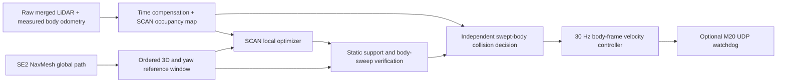

# ScanPlanner + M20

[简体中文](#简体中文)

The integration uses a fresh, pinned checkout of the **ROS 2 community port** of [SCAN-Planner](https://github.com/wuyi2121/SCAN-Planner/tree/ros2-community), commit `d0b921c9b05a6d291d144d60882b2e0e88d2c0e0`. The original Jetson `SCAN-Planner` directory and its configuration remain separate. Bag replay and stationary live-sensor integration have been validated; physical closed-loop walking and autonomous multi-floor walking have not been commissioned.

## Run

All downloads, patches, build products, logs and replay sessions stay inside `se2_nvblox_surface_shadow`:

```bash
# One-time build, on the Jetson with ROS 2 Humble and this project's dependencies.
bash /home/nvidia/scanplanner_test/se2_nvblox_surface_shadow/scanplanner_integration/install.sh

# Latest bag and its saved global map; isolated ROS domain 80; no robot UDP output.
bash /home/nvidia/scanplanner_test/se2_nvblox_surface_shadow/scanplanner_integration/start.sh
```

Use **Publish Point** in RViz to choose a floor. The start uses the current recorded **body pose and measured body height**, including yaw. During a global query, the session pauses a running bag and resumes it after the result; a bag already paused by the operator stays paused. The controller's wall-clock watchdog remains active during a pause.

Yellow: global path. Purple: current body-reference window. Cyan: accepted local path, displayed at floor height. Point cloud: current world-frame LiDAR returns. `Ctrl+C` stops only this session's processes. The existing tuning GUI and real-time reconstruction remain separately owned.

```bash
# Choose a bag/map explicitly.
bash scanplanner_integration/start.sh --bag /absolute/path/to/bag --map /absolute/path/to/map

# Headless performance run; metrics.json and samples.json are written per session.
bash scanplanner_integration/start.sh --no-rviz

# Live sensor/processing test only: no navigation route and no robot UDP output.
bash scanplanner_integration/start.sh --live --sensors-only

# Saved map + live localization, global/local planner and RViz; telemetry only.
# Start near the map recording origin when no valid current-LIO cache exists.
bash scanplanner_integration/start_live.sh

# Normal walking profile, including an explicit navigation-mode request.
bash scanplanner_integration/start_live.sh --execute --enter-navigation

# Stop the owned session from another terminal.
bash scanplanner_integration/stop.sh
```

`start_live.sh` uses the saved map with live inputs and never starts rosbag playback. It expands to `start.sh --live --localize-at-start`. The former `--map-aligned` assertion is rejected: a measured map match is required. `--execute` enables the M20 UDP sender; without it, the same receiver publishes live body height but sends only telemetry heartbeats. The robot must already be standing/in RL control, facing forward, awake, and free of a hard emergency stop. The default live `normal` profile limits forward speed to 0.50 m/s, lateral speed to 0.25 m/s and yaw rate to 0.60 rad/s. `--speed-profile slow` restores the earlier 0.15 / 0.10 / 0.30 commissioning limits. The normal profile also raises trajectory lookahead from 0.15 to 0.50 seconds, within the existing one-second swept collision check; changing only the speed cap would leave startup commands near 0.08 m/s. Choose a nearby goal on the same floor; physical stair trials remain unvalidated. First global queries can take about 20–30 seconds while the fast controller continues to run.

`--enter-navigation` requires `--execute`. It sends the documented Type 1101 / Command 5 request with Mode 1, at most three times, and waits for measured status to enable motion. It never stands the robot up. Mode changes reset the M20 gait to its base gait, so this convenience option is intended for the initial level-ground trial. Once navigation mode is confirmed, later operator mode changes stop velocity output and are not overridden. Normal exit sends zero velocities, then makes a best-effort request to restore the previous mode if this process changed it and the operator has not changed it again. UDP delivery cannot be guaranteed after a network failure.

The map matcher accumulates five recent scans, compensates each point using measured odometry, and checks held-out points against saved mesh surfaces. Startup needs five stable matches; tracking uses surface-normal alignment to avoid tangential floor drift. The transform cache is tied to the mesh checksum and the exact running LIO publisher GID, and is revalidated on every session. A new publisher or odometry discontinuity invalidates it. The separate `se2_scan_map` frame and `/se2_scan/aligned_odom` preserve the existing localization configuration. The C++ bridge applies fresh map transforms to raw body odometry, avoiding a Python relay in the high-frequency sensor path. An expired transform stops command authorization.

## Data flow



Live mode uses ROS domain 0 and the existing `~/.config/fastdds/eno1.xml` UDP/SHM profile; `SE2_SCAN_LIVE_DDS_PROFILE` can select another verified profile. Replay stays in localhost-only domain 80 with its separate SHM-only profile. An earlier probe accidentally used that replay profile and missed the live publishers. With the corrected profile, live LiDAR and body odometry were observed at approximately 10 Hz and 200 Hz.

The first sensor-only probe exposed missing telemetry startup and control-period outliers; that historical result is retained in the validation JSON. The complete live startup now owns the height receiver. In the final stationary live trial, an RViz goal produced a checked global path, an accepted local spline and verified turning commands. Cancellation returned commands to zero. Control ran at approximately 30 Hz; decision P95 with an active trajectory was about 34 ms, with a maximum about 51 ms. Rare overall decision outliers remain above 50 ms. Hardware output stayed disabled. These measurements support an operator-supervised low-speed first trial, not a hard real-time guarantee or a completed physical navigation trial.

The 50 ms target applies to **raw-cloud callback ingress → updated occupancy map → collision/stop decision**. It includes waiting for bracketing odometry, time compensation, point filtering, map update and collision checks. It excludes sensor acquisition/driver delay before callback ingress. Sensor age is logged separately. A fresh optimized, geometrically verified detour is a separate asynchronous result; it must not be equated with the fast stop decision.

The optimizer and global planner run outside the control process. The controller emits at 30 Hz, also while an optimizer is busy. A stopped or stalled planner, stale LiDAR/odometry, missing measured height, invalid path, cancelled goal or lost route heartbeat causes zero velocity. The optional UDP sender independently requires a fresh command and fresh robot telemetry.

`fsm.max_replan_period: 0.3` refreshes an unfinished local plan at least every 0.3 seconds of ROS time during normal operation. The original `thresh_replan` is a distance: at commissioning speeds it allowed roughly three seconds between plans, exceeding the controller's one-second trajectory lease. Periodic refresh uses measured distance to the target; each new candidate still passes geometric validation. The trajectory lease and sensor watchdogs remain unchanged, so a stalled planner still stops the robot.

## Geometry and changes to upstream

- Floor XYZ and body yaw remain in `/se2_global/path`. `/nvblox_lio/odom` must be `nvblox_odom → base_link_dog`. `MotionStatus.Height` converts floor positions to body-reference Z; the old constant estimate is not reused.
- Route progress uses ordered 3D segments, so overlapping floor XY coordinates cannot jump the route to another storey. In-place turns remain explicit. Interpolated yaw uses the shortest angular interval, rather than replacing body heading with travel tangent.
- The upstream path handler checks frames, cancels on an empty path and removes zero-length polynomial segments. The local optimizer is initialized from the ordered 3D window and retains its height profile; a route guide limits smoothing away from it.
- Optimized curves must pass the saved map's support and physical-body checks. Complete polygon/yaw proofs use the same semantics as the global planner; refined bits never become whole-cell permission. If smoothing leaves the certified corridor, a zero-end-speed cubic along the next checked reference segment can be used. This fallback is separately reported and still passes the live occupancy guard.
- The fast guard uses the M20's 0.82 × 0.506 m rectangle, including corners. The current torso envelope extends from body Z −0.10 m to +0.40 m; static mesh verification checks the full configured height and ground support. The local occupancy resolution is 0.10 m, with conservative voxel intersection handling; very tight passages can therefore stop even when the finer global model admits them. Pitch/roll-dependent swept geometry and live negative-obstacle detection are not implemented in this SE(2) integration.
- The LiDAR update runs immediately in the cloud callback. Visualization runs at 5 Hz. Point time compensation uses measured poses without extrapolation and retains one return per 4 cm world voxel. The existing verified merged NX cloud convention (`lidar_link` / `base_link_dog`, body-aligned) is required; the manual's translation table is not treated as a sensor rotation calibration.
- `p_hit=0.97` ensures one occupied return can cross the occupancy threshold even from the minimum free log odds. The earlier value required a second 10 Hz frame at a previously free cell, adding about 100 ms before stopping.

The fixed patch is in [`scanplanner_integration/patches/`](../scanplanner_integration/patches/), with source provenance in [`UPSTREAM.json`](../scanplanner_integration/UPSTREAM.json). The original upstream ROS 1 algorithm and this ROS 2 port are distinct releases.

## M20 wire protocol

The sender implements the supplied basic_server documentation: UDP `10.21.31.103:30000`; 16-byte `EB 91 EB 90` header; little-endian ASDU length/sequence; JSON format 1. Type 2 / Command 25 uses **m/s and rad/s** (`X`, `Y`, `Yaw`) without the old normalized-axis multipliers. It sends at 30 Hz and sends a Type 100 / Command 100 heartbeat at 2 Hz. The sender rejects velocities exceeding ±0.50 m/s forward, ±0.25 m/s lateral or ±0.60 rad/s yaw. The selected controller profile can impose lower limits.

Telemetry must report navigation usage mode, no hard emergency stop, forward direction, awake status and standing/RL motion state. Nonzero errors latch a stop until restart. The authoritative velocity topic is `/se2_scan/cmd_vel_stamped`; commands older than 120 ms are rejected by source timestamp. `/se2_scan/cmd_vel` remains available for observation. Mode changes occur only under the explicit `--enter-navigation` option described above.

The sender retains only the newest velocity message. A five-message queue at a 30 Hz source could remain stale after a short consumer stall, leaving a visible global route but zero motor commands. A localhost regression reproduces the failure and checks recovery after a 450 ms consumer stall, rejection of stale timestamps, and subsequent recovery. The 120 ms watchdog is unchanged. Telemetry-only sessions also inspect incoming commands without sending velocities; `telemetry/status.json` records received/accepted counts, rejection reasons, source age and the active stop reason.

## Validation and logs

Each run writes to `scanplanner_integration/runtime/<timestamp>/`:

| File | Purpose |
| --- | --- |
| `session.json` | Exact arguments, child processes, completion/failure and hardware-output mode |
| `metrics.json` | P50/P95/P99/max, frame replacements/drops, active-trajectory timing, control frequency and slow periods |
| `samples.json` | Per-frame and per-command samples for reproducible analysis |
| `bridge.log`, `optimizer.log`, `route.log` | Sensor rejection, local optimization and geometry decisions |
| `global.log`, `player.log`, `rviz.log` | Global query, playback and display lifecycle |
| `telemetry/status.json` | M20 usage mode, command acceptance/rejection counts, stop reason and UDP packet counts |

A recorded bag supplies recorded odometry, so commands cannot change its route. If it walks away from the selected planned corridor, the bridge stops and reports `replan_required`. This is expected in open-loop replay, not a closed-loop navigation success. Performance of a complete verified detour is reported separately from the fast collision decision. See [`scanplanner-validation.json`](scanplanner-validation.json) for measured results and test scope.

```bash
python -m unittest discover -s scanplanner_integration/tests -v
# On Jetson, after sourcing ROS and scanplanner_ws/install/setup.bash:
ROS_DOMAIN_ID=81 ROS_LOCALHOST_ONLY=1 python scanplanner_integration/tests/ros_guard.py --output scanplanner_integration/runtime/guard_test
ROS_DOMAIN_ID=81 ROS_LOCALHOST_ONLY=1 python scanplanner_integration/tests/udp_loopback.py
ROS_DOMAIN_ID=81 ROS_LOCALHOST_ONLY=1 python scanplanner_integration/tests/udp_backlog.py
```

## 简体中文

已在项目内部下载并部署独立的 ScanPlanner ROS 2 源码，不复用或改写旧 `SCAN-Planner` 工作区。默认启动命令：

```bash
bash /home/nvidia/scanplanner_test/se2_nvblox_surface_shadow/scanplanner_integration/start.sh
```

默认加载最新 bag 及与它绑定的全局图，在独立 ROS 域 80 中运行。RViz 使用 **Publish Point** 选目标楼层，起点来自当前包内机身位姿和实测机身高度。全局规划期间自动暂停正在播放的 bag，得到结果后恢复；控制始终受墙钟超时保护。黄色为全局路线，紫色为机身参考窗口，青色为通过校验的局部轨迹。默认不向机器狗发送运动指令，`Ctrl+C` 只关闭本次会话。

加上 `--live --sensors-only` 仍可单独测试实时点云。完整实时入口为 `start_live.sh`：只读取建好的地图，输入全部来自实时雷达、SuperLIO 和 M20 状态，不播放 bag。已修复机身高度接收器漏启，并加入真实点云配准；变换绑定地图校验和及本次 LIO 发布者，重启会重新验证，不能用 `--map-aligned` 声明绕过。它使用独立的 `se2_scan_map` 坐标系，不覆盖原有定位或传感器 TF。

实时正常速度启动命令：

```bash
bash /home/nvidia/scanplanner_test/se2_nvblox_surface_shadow/scanplanner_integration/start_live.sh --execute --enter-navigation
```

机器人须已起立或进入 RL 控制。此命令显式请求切换导航模式，收到状态确认后才允许执行 RViz 目标；切换模式会恢复基础步态。默认 `normal` 档上限为前进 0.50 m/s、侧向 0.25 m/s、转向 0.60 rad/s。追加 `--speed-profile slow` 可恢复原来的 0.15 / 0.10 / 0.30 低速档。正常档还将轨迹前视时间从 0.15 秒改为 0.50 秒，仍位于原有 1 秒轨迹碰撞检查范围内；只提高限速会让零初速轨迹的起步指令仍停留在约 0.08 m/s。首条全局路径约需 20–30 秒。`Ctrl+C` 或 `stop.sh` 关闭本次会话；程序先发零速度，再尽力恢复由它切换前的使用模式。操作员中途切换模式时，程序不会自动抢回控制。

最新静止实机测试已验证地图定位、实测高度、全局目标、局部轨迹、转向控制输出和取消停车，硬件端始终为只读状态。控制约 30 Hz；活动轨迹下雷达回调至避障决策 P95 约 34 ms、最大约 51 ms，仍有少量超过 50 ms 的峰值。初期探测中出现过启动长周期，旧结果保留在验证记录中。实际行走闭环、极窄通道和楼梯执行仍需现场试验，不能把静止输出指令当成已经完成导航。

50 ms 指标明确测量“原始雷达点云进入回调 → 地图更新 → 碰撞/停车决策”。传感器采集至进入回调的延迟单独记录；完整绕障轨迹的优化与几何校验耗时也单独统计，不能用停车延迟代替。控制输出设为 30 Hz，并记录实际周期及超过 50 ms 的次数。

跨楼层的高度、路线顺序和指定朝向会保留。局部平滑不能跨过全局图中的支撑缺口；不满足校验时，尝试下一段已验证的参考路线，仍受实时雷达碰撞检查约束。没有可用路线、数据过期、定位失效或取消目标时输出零速度。局部 10 cm 占据栅格仍可能比全局细粒度通行图保守，实机极窄通道和跨楼层闭环行走尚未验收。

M20 接口按文档使用真实速度单位，发送频率 30 Hz，没有沿用旧控制器的倍乘系数。速度携带来源时间戳，超过 120 ms 的旧指令不能刷新看门狗。断流、定位变换过期、缺少机身高度、取消目标或校验失败时停车。若当前机身与保存地图中的障碍相交，会拒绝起点；本次现场确认过一处小型孤立 Mesh，未通过删除障碍或绕过碰撞检查强行放行。

已修复“黄色路径存在但机器狗不动”的指令积压问题：发送端原先缓存 5 帧，短暂卡顿后会持续消费过期速度，触发超时停车；现在只保留最新一帧，120 ms 看门狗保持不变。回环测试覆盖暂停接收进程 450 ms 后恢复、拒绝过期指令、重新接收新指令。只读会话同样检查速度接收链路，且不发送运动包。`telemetry/status.json` 新增接收/接受数量、拒收原因、时间戳延迟、停车原因及实际 UDP 发送数量。

同时修复低速规划更新与轨迹有效期不匹配的问题：原 `thresh_replan` 是距离阈值，低速时约 3 秒才更新一次，而控制器要求轨迹在 1 秒内更新。新增 `fsm.max_replan_period: 0.3`，在正常运行时每隔最多 0.3 秒 ROS 时间刷新未完成路线，以实测位置判断是否仍未到达；每条新轨迹继续做几何校验，1 秒轨迹有效期和传感器超时保护保持不变。

日志与数据均保存在 `scanplanner_integration/runtime/`，源码和构建结果位于 `scanplanner_ws/`，不会在项目同级新增文件夹。详细实测结果见 [`scanplanner-validation.json`](scanplanner-validation.json)。

## Known issue

As of September 30, 2026, the operator observed the M20 move through two short sections and then stall. Localization and UDP command reception remained available. The saved-map checker rejected a direct connection from the measured pose to the next route segment; the existing fallback repeatedly targeted a nearby reference point and produced very small corrections. The operator reported a clear area, consistent with the captured nearby LiDAR returns. Route recovery is unresolved in this snapshot; no automatic replanning or recovery fix has been applied. Stationary command tests do not establish completion of a physical navigation route.

截至 2026 年 9 月 30 日，实机出现行走两小段后停滞的问题。定位和 UDP 指令接收仍正常，但保存地图的校验拒绝从实测位置直接接入下一段路线，现有回退逻辑反复追踪附近参考点，产生很小的修正。现场反馈附近空旷，与采集的近处雷达回波一致。本次上传保留当前状态，停滞恢复尚未修复，也未加入自动重新规划；静止状态的指令测试不能作为实机完成整条导航路线的证明。
